# CFR Complaint Intelligence V2 — Decision-Driven High-Level Design

**Document ID:** CFR-V2-HLD-001  
**Version:** 1.2.0 — reviewed revision (preserves v1.1 narrative and diagrams)  
**Date:** 2026-10-13  
**Status:** Architecture review conditional pass; agreed design retained; technical clarifications proposed; critical business semantics pending approval  
**Scope:** Complaint ingestion, evidence investigation, agentic reasoning, classification, severity, publication, governance, and operations.

> **Reading guide.** Begin with Part I for the whole system. Part II walks through ADR-01–ADR-17 sequentially. Every ADR opens with a motivating question, references stable component IDs, compares alternatives, documents the selected direction, supplies an implementation view and a diagram, and explains consequences. Parts III–VI bring the decisions together. **Agreed** means agreed in our design discussion, not formally approved by the organization. **Proposed** means a recommendation requiring verification. **Open** means a decision that must not be silently assumed.


## Contents

- [Part I — Overall architecture](#part-i--overall-architecture)
- [Part II — Sequential architecture decision records](#part-ii--sequential-architecture-decision-records)
- [Part III — Consolidated architecture views](#part-iii--consolidated-architecture-views)
- [Part IV — Contracts, governance, and operational design](#part-iv--contracts-governance-and-operational-design)
- [Part V — NFRs, evaluation, and migration](#part-v--nfrs-evaluation-and-migration)
- [Part VI — Decision register and sign-off](#part-vi--decision-register-and-sign-off)
- [Part VII — v1.2 architecture review resolutions](#part-vii--v12-architecture-review-resolutions)

# Part I — Overall architecture

## I.1 Why V2 exists: baseline and problem statement

The baseline CFR solution accepts complaint transcripts (primarily call transcripts), creates case notes, routes cases to complaint verticals, retrieves policy/customer/history/past-case evidence, and produces Amex-error classification, supporting reasoning, and 0–1 severity. Its vertical skill/knowledge documents encode domain-specific definitions, examples, sources, and severity criteria. The current repository README describes BigQuery transcript ingestion, CHC FAISS+SQLite retrieval, historical/similar case retrieval, structured customer-data serialization, an alternative LightRAG CHC pipeline, and optional majority voting. **The README explicitly says LightRAG is not consumed by default by the main inference path.** This V2 HLD is a target design, not a statement that the new services already exist.

### Baseline architecture (source-derived)

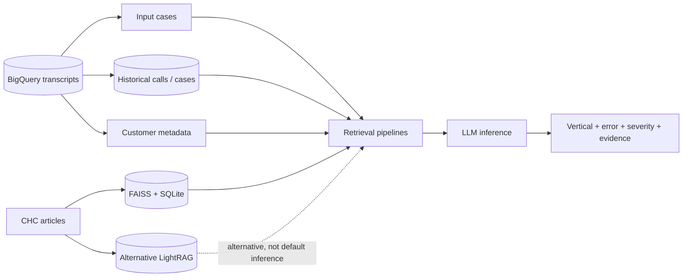

### Five V2 outcomes

1. **Accuracy:** reduce false positives and false negatives at claim and case level.
2. **Explainability:** every finding has proposition-level evidence and applicable-policy lineage.
3. **Adaptive investigation:** choose verticals and evidence tasks based on allegations and evolving gaps.
4. **Extensibility:** independent vertical reasoning implementations, shared contracts and capabilities.
5. **Production readiness:** durable hybrid execution, isolation, retries, release governance, security, and evaluation.

## I.2 Architectural principles

| Principle | Invariant |
|---|---|
| Governed autonomy | LLMs propose plans and findings; deterministic controllers authorize execution and commit state. |
| Evidence before conclusion | Transcript allegations are not treated as independently verified facts. |
| Source-aware time | Event-time validity and source observation time must not be conflated. |
| Isolated vertical contexts | Vertical programs see only scoped immutable context packages. |
| Shared evidence capabilities | Agents request logical capabilities, never hardcode a vector database or arbitrary SQL. |
| Mandatory validation | Every accepted proposal has a critic; every complaint passes reconciliation. |
| Global business semantics | Error aggregation and severity aggregation are globally configured, not selected by verticals. |
| Durable lineage | Accepted artifacts, program versions, evidence and calculation inputs are reconstructable. |
| Explicit uncertainty | UNDETERMINED, unavailable evidence and incomplete severity are never silently coerced to NO or zero. |

## I.3 Component index (stable IDs)

| ID | Component | Primary responsibility |
|---|---|---|
| C01 | Intake and Admission | Normalize transcripts, create run, idempotency, batch/API ingress. |
| C02 | Complaint Understanding | Pass 1 allegation extraction, Pass 2 grounding, minimal LUMI hydration. |
| C03 | Primary Claim Selector | DSPy-selected controlling allegation, before error assessment. |
| C04 | Candidate Router | Claim-to-vertical candidate generation. |
| C05 | Dynamic Planner and Controller | Proposed task DAG, validation, activation, budgets and replanning. |
| C06 | Durable Workflow Runtime | Task scheduling, history, retries, timeouts, recovery (Temporal candidate). |
| C07 | Evidence Retrieval Platform | Logical capability registry, fixed strategies, backend adapters. |
| C08 | Evidence Coverage Gate | Deterministic required/conditional/preferred source coverage. |
| C09 | Vertical Reasoning Runtime | Independently implemented bounded DSPy/RLM programs. |
| C10 | Consolidated Critic | Mandatory direct proposal critique and semantic sufficiency. |
| C11 | Reconciliation | Mandatory case-level consistency and impact relationship validation. |
| C12 | Decision Engine | Global B1/B2 and dual severity aggregation. |
| C13 | Publication Gateway | Atomic readiness, immutable decision commit, transactional outbox. |
| C14 | Case State and Evidence Catalog | Versioned claims, evidence, assessments, lineage and state transitions. |
| C15 | Artifact and Registry Services | Immutable source/output artifacts, skills, programs, release manifests. |
| C16 | Optimization and Evaluation | Offline DSPy tuning, golden datasets, regression, approval. |
| C17 | Security and Observability | IAM, RLM sandbox, tracing, audit access, metrics. |
| C18 | Follow-up and Review | Unresolved claim obligations, human review and linked reprocessing. |

## I.4 Complete logical component flow

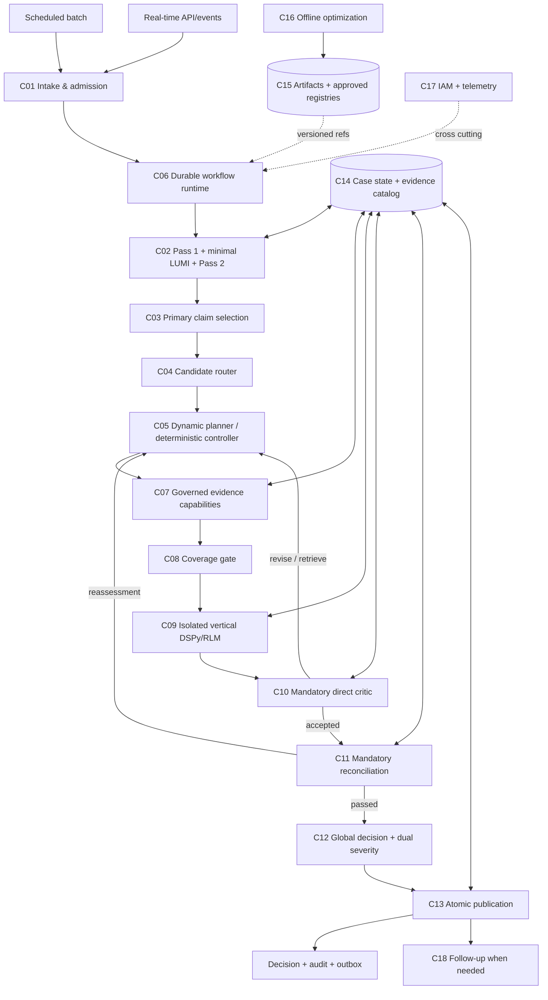

### Reviewed execution path (v1.2 clarification)

The original flow above remains the conceptual overview. The following diagram adds **C18 disposition management** before reconciliation and independent error/severity readiness after reconciliation. An unresolved claim is not represented as a fabricated accepted assessment.

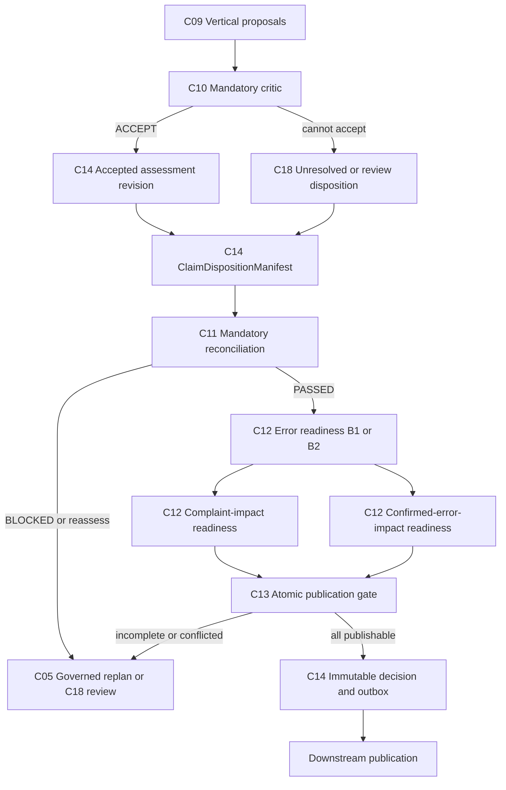

**Invariant:** reconciliation invocation is mandatory; a `PASSED` reconciliation does not by itself establish conclusive error, final severity, or publishability.


## I.5 One-case lifecycle and outcome semantics

The workflow starts with a canonical transcript and immutable release manifest. Pass 1 preserves the customer's allegation; baseline LUMI hydration can run in parallel. Pass 2 grounds entities, C03 selects a primary claim, C04/C05 activate appropriate verticals, C07 gathers evidence, C08 reports coverage, and C09/C10 propose and critique assessments. C11 reconciles all accepted assessments, C12 calculates error and severity, and C13 publishes **both together** only when readiness passes. Under decision-aware F2, unresolved non-blocking secondary claims remain as explicit C18 follow-ups. Neither a timeout nor missing evidence implies NO.

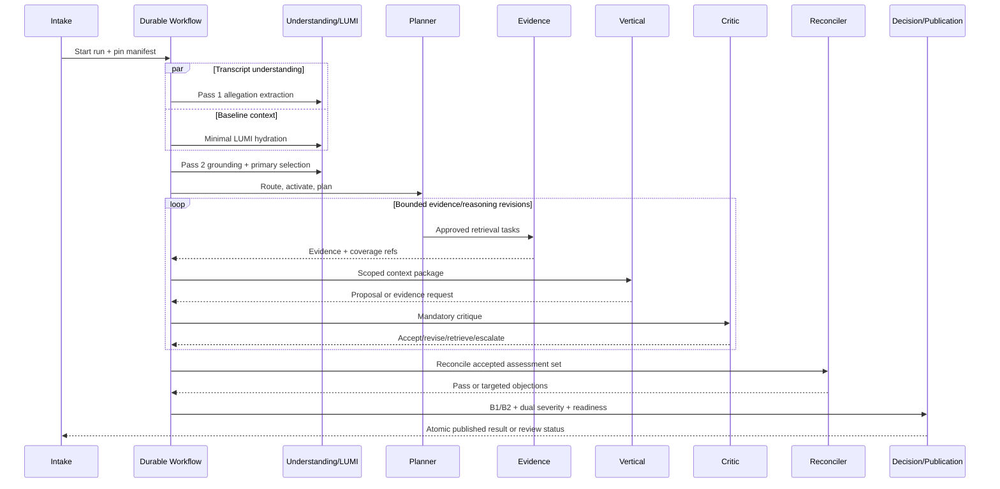

# Part II — Sequential architecture decision records

> **ADR cross-reference convention:** Each record identifies components (Cxx), upstream decisions, downstream consumers, and tests. Options and conclusions reflect the working design discussions; any missing numerical threshold or field mapping is explicitly marked open.

## ADR-01 — Hybrid batch/real-time and governed dynamic orchestration

**Opening question/scenario.** A call complaint arrives in a daily batch, while a chat complaint arrives through an API. Both may need parallel policy, customer and history evidence, and later a critic may request a new source. How do we support dynamic investigation without two incompatible processing pipelines?

**Architecture location:** C01 → C06 → C05 → C07/C09; affects all downstream components. **Status: Agreed logical execution model; Temporal is a preferred candidate, not approved.**

**Requirements.** Same classification semantics across modes; durable case state; parallel independent tasks; dependency-aware scheduling; bounded replanning; separate latency and throughput controls; explicit task permissions; resumability.

| Alternative | Strength | Weakness | Outcome |
|---|---|---|---|
| Fixed sequential pipeline | Simple, predictable | Cannot adapt to evidence gaps or multi-vertical cases | Not selected |
| Fully autonomous agent owns tools and state | Flexible | Unbounded actions, hard audit and recovery | Not selected |
| Dynamic DSPy planner + deterministic controller + durable runtime | Adaptive with enforceable invariants | More contracts and workflow logic | **Selected** |

**Decision.** The planner proposes a declarative task DAG. The controller validates capability IDs, dependencies, access, cost, mandatory gates and budgets. The runtime executes approved tasks and persists transitions. Batch and real-time share workflow definitions but have distinct admission and capacity lanes.

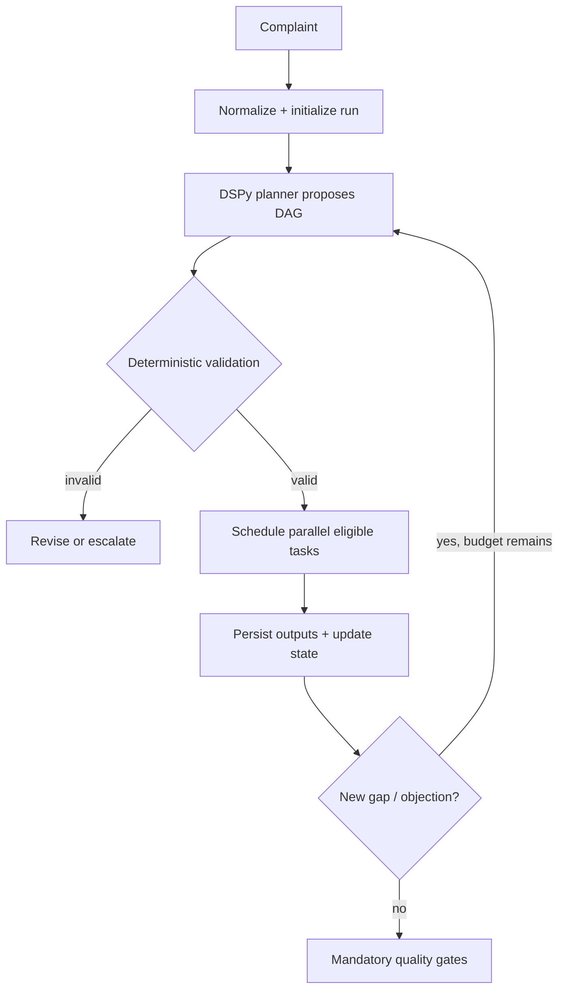

**Contracts.** `TaskEnvelope`, `TaskResult`, `ExecutionPlan`, `PlanRevision`, `CapabilityDescriptor`, `ExecutionBudget`. Controller-owned stages must include critic, reconciliation and publication readiness even if omitted by the planner.

**Trade-offs.** Parallelism reduces critical-path latency but increases peak source/model concurrency; durable execution improves recovery but adds operational overhead; dynamic plans need strict idempotency and no-progress detection. **Tests:** DAG cycle rejection, unauthorized capability rejection, parallel scheduling, crash/resume, task retry without duplicate accepted state.

**HLD impact:** Establishes C05/C06 as control plane and forbids agents from owning workflow state. **Links:** ADR-07 activation, ADR-11 critique, ADR-12 runtime, ADR-13 sizing.

### v1.2 review clarification — admission and workload fairness (proposed)

**Scenario.** The batch coordinator admits 100,000 cases while real-time requests arrive. Separate task queues alone do not reserve model-gateway quota. C01 must enforce a stable admission key `(source_system, source_case_id, ingestion_revision)` and record duplicate submissions; C05/C06 apply bounded inflight tasks, queue fairness and per-lane concurrency; C17 observes starvation and backlog age. A workflow may reach a durable processing disposition without publishing a decision. **Tests:** duplicate ingestion, saturated batch queue, model-quota exhaustion, real-time reserved-capacity behavior. **Links:** ADR-12, ADR-13, ADR-17.


## ADR-02 — Minimal LUMI baseline hydration + on-demand enrichment

**Opening question/scenario.** Every transcript can be linked to customer demographics/account context in LUMI. Should we attach all customer data to every prompt, or retrieve it when the complaint needs it?

**Architecture location:** C01/C02 initial context; C07 structured capabilities; C14 evidence; C17 privacy. **Status: Agreed strategy; exact baseline attribute list open.**

| Alternative | Accuracy/context | Latency/cost | Privacy | Decision |
|---|---|---|---|---|
| Full eager profile | Broad context | High payload/token cost | Broad exposure | Rejected |
| All on demand | Minimal upfront | Repeated source queries, weak initial grounding | Good minimization | Rejected as sole mode |
| Minimal baseline + targeted enrichment | Enough for grounding, deeper data when needed | Balanced; supports batch prefetch | Scoped | **Selected** |

**Decision.** A minimal approved profile is hydrated at admission or alongside Pass 1, then additional customer facts are fetched through typed logical capabilities. Candidate baseline categories: customer/account references, product/relationship identifiers and permitted routing attributes. **No exact LUMI columns or demographic fields are approved in this HLD.** Sensitive attributes require a documented purpose and authorization. Each fact records source and observation time; event-time history is addressed in ADR-15.

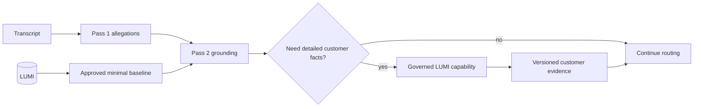

**Accuracy risk.** Eagerly supplied unrelated demographics can create spurious correlations; too little context can misground products or accounts. **Latency optimization:** bulk baseline hydration for scheduled batches, subject to approved snapshot semantics and quotas. **Tests:** grounding accuracy with/without baseline, source query counts, sensitive-field minimization, temporal correctness.

**HLD impact:** C02 receives minimal case context; C09 does not hold unrestricted LUMI credentials. **Links:** ADR-03, ADR-07, ADR-10, ADR-15.

### v1.2 review clarification — LUMI access contract (proposed)

**Scenario.** A baseline profile is retrieved in bulk, but an account fact changes during the eight-hour batch. C02 should record the approved attribute allowlist, hydration observation timestamp, source query/template version, purpose and case-scope; C07 must not claim that all case workflows share a transactionally consistent LUMI snapshot. An event-time query can be marked `HISTORICAL_VERIFIED` only if the underlying source provides the required historical semantics. `CURRENT_ONLY` and `UNKNOWN` remain explicit. Cache reuse requires approved TTL, purpose and authorization constraints. **Open:** actual LUMI field allowlist, source history support, and data-governance approval. **Links:** ADR-03, ADR-13, ADR-15.


## ADR-03 — Two-pass decomposition: allegations before grounding

**Opening question/scenario.** A customer says “you declined my transaction,” but LUMI shows a later account restriction. How do we avoid changing what the customer alleged merely because external data suggests a different narrative?

**Architecture location:** C02; outputs to C03/C04/C05 and C14. **Status: Agreed — two-pass Option C.**

| Alternative | Strength | Risk | Decision |
|---|---|---|---|
| One-shot transcript + all evidence | Few stages | Conflates allegation with verified fact | Not selected |
| Transcript-only extraction throughout | Strong fidelity | Poor entity grounding and evidence planning | Not selected |
| Pass 1 immutable allegations; Pass 2 contextual grounding | Fidelity + grounded investigation | Two artifacts and additional model work | **Selected** |

**Pass 1:** Extract atomic allegations, source spans, issue/intent indicators, ambiguity, and impact statements separately. Do not inject LUMI evidence into this extraction. **Pass 2:** Resolve entities and event windows, clarify ambiguity, attach context, derive evidence needs. Corrections produce new revisions, not silent edits to original allegations.

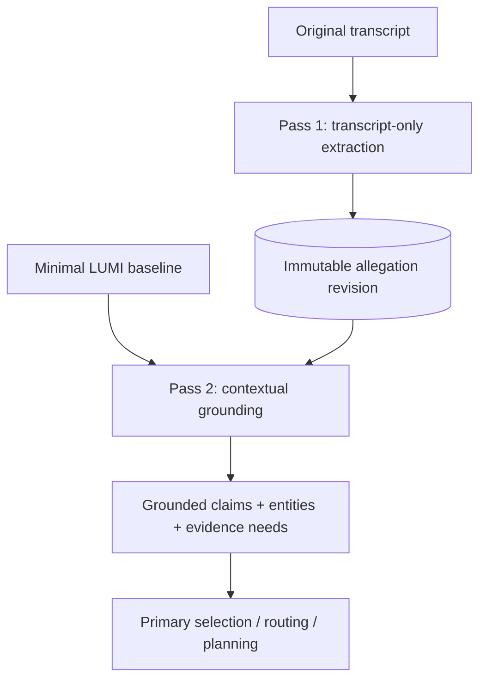

**Data contracts.** `Allegation` (ID, span refs, text, claim/impact distinction, ambiguity), `GroundedClaim` (allegation ref, entity refs, event interval, evidence needs, grounding status), source/version/hash metadata.

**Trade-offs.** Additional inference versus lower source-contamination risk; Pass 1 recall is critical because missed allegations cannot be rescued by later routing. **Tests:** allegation recall/precision, hallucinated-claim rate, span validity, grounding correctness, revision lineage.

**HLD impact:** C02 is explicitly two stages and creates distinct artifacts; C03 must operate before classification. **Links:** ADR-02, ADR-04, ADR-07, ADR-16.

### v1.2 review clarification — claim-set revision and selector invalidation (proposed)

**Scenario.** New evidence reveals that two extracted allegations were actually one, after C03 already selected a primary claim. C02 creates a new immutable claim-set revision; C14 records `claim_set_hash`. Any C03 selection referencing the old hash becomes **STALE** for B2 readiness. C05 schedules selection revalidation or rerun before aggregation; C04 activation and C09 assessment dependencies are checked against the new claim IDs. No historical claim/selection artifact is overwritten.

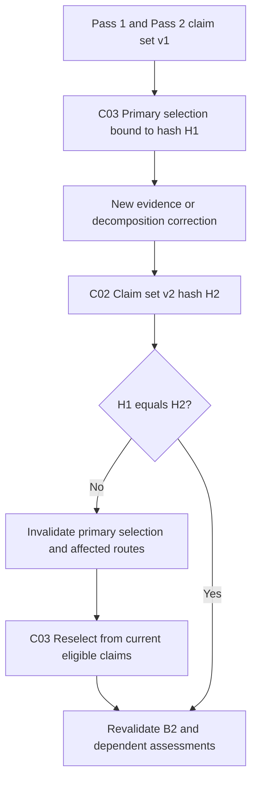

**Tests:** split claim, merged claim, removed primary claim, changed eligible allegation, B1 unaffected by ambiguous primary. **Links:** ADR-07, ADR-16.


## ADR-04 — Selective DSPy RLM for long transcripts and complex evidence

**Opening question/scenario.** A complaint has a very long transcript or dozens of conflicting documents. Is a single prompt sufficient, or should recursive analysis be used for difficult cases?

**Architecture location:** C02 allegation extraction and C09 evidence reasoning; C06 budgets; C17 sandbox; C16 evaluation. **Status: Agreed scope C — selective RLM in both areas.**

| Alternative | Benefit | Drawback | Decision |
|---|---|---|---|
| Never use RLM | Predictable and inexpensive | May struggle on long context | Not selected as blanket rule |
| RLM for every case | Rich exploration | High and variable cost/latency | Not selected |
| Selectively route eligible cases to RLM | Complexity-aware quality/cost | Requires validated routing criteria | **Selected** |

**Decision.** Standard DSPy is default. Approved complexity policy may select RLM for long allegation extraction or complex scoped evidence analysis. RLM can explore only supplied authorized content; external retrieval must be requested through C05/C07. Resource controls: wall-clock deadline, model-call/token limits, recursion/iteration budget, sandbox CPU/memory, restricted filesystem/network/credentials.

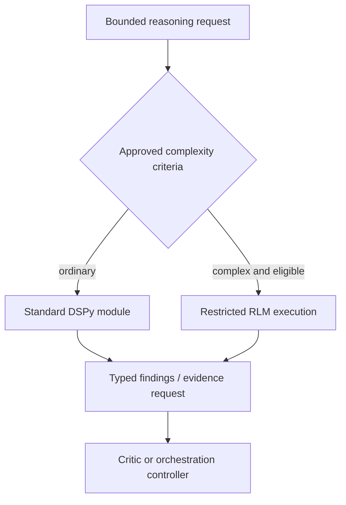

**Trade-offs.** Potential better long-context coverage versus recursive call amplification, difficult failure diagnosis, and sandbox risk. **Tests:** RLM vs standard DSPy accuracy, token and latency distributions, runaway recursion, sandbox escape prevention, structured output quality. **Open:** numerical activation thresholds and model budgets.

**HLD impact:** C09 supports multiple internal reasoning strategies without creating a second durable orchestrator. **Links:** ADR-03, ADR-11, ADR-12, ADR-14.

### v1.2 review clarification — enforceable RLM sandbox (proposed)

**Scenario.** A recursive reasoning program attempts to open a network socket or access worker credentials. C17 must enforce restricted process/container isolation, default-deny egress, no LUMI credentials, scoped artifact inputs, CPU/memory quotas, model-call and token limits, wall-clock termination, and audited sandbox failures. C06 must be able to terminate an uncooperative task and record a technical failure distinct from a business `UNDETERMINED`. RLM activation thresholds and permitted code execution remain subject to evaluation and security approval. **Tests:** egress denial, secret exposure, infinite loop, oversized context, crash and cancellation. **Links:** ADR-12, ADR-13.


## ADR-05 — Backend-agnostic evidence retrieval

**Opening question/scenario.** V1 uses FAISS and has an alternative LightRAG path. What if policy retrieval moves to PGVector, or another source is introduced? Should vertical programs be rewritten?

**Architecture location:** C07, C14, C15; C05 calls logical capabilities. **Status: Agreed abstraction; refined by ADR-15.**

| Alternative | Advantage | Problem | Decision |
|---|---|---|---|
| Vertical directly calls FAISS/LightRAG | Fast initial coding | Vendor coupling and fragmented access | Rejected |
| One universal vector-store API for all data | Uniform surface | Forces structured customer facts into unsuitable semantics | Rejected |
| Business capability → strategy → adapter | Extensible and source-appropriate | Requires registries and normalization | **Selected** |

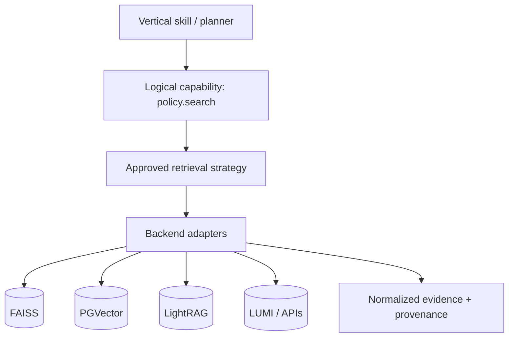

**Contracts.** Typed capability-specific request/response wrapped by common `RetrievalRequest`/`RetrievalResult`, source IDs, index generation, retrieval execution ID, access scope, status and evidence references. **Tests:** backend conformance, source citation validity, permissions, missing-source behavior, quality comparison on same cases.

**HLD impact:** Vertical implementations depend on capability names, not physical stores. **Links:** ADR-07, ADR-10, ADR-15.

### v1.2 review clarification — adapter conformance (proposed)

**Scenario.** A replacement backend returns search hits but cannot provide policy effective-date filtering or resolvable citations. C07's backend registry must declare supported filter operators, temporal semantics, citation/source-resolution guarantees, score semantics and index-version behavior. The capability configuration is rejected if required features are missing; C15 promotion tests include citation resolution and authorization. Backend independence is **interface portability**, not equivalent retrieval quality. **Tests:** missing filter, invalid source ID, mixed score scales, retired index, unauthorized source. **Links:** ADR-15.


## ADR-06 — Hybrid vertical reasoning with shared contracts and independent implementations

**Opening question/scenario.** Authorization, RLI, RLA and New Accounts have different error definitions, severity rubrics and examples. How can each evolve independently without duplicating infrastructure?

**Architecture location:** C09, C15, C16; shared C07/C10/C14. **Status: Agreed — shared contracts, independent implementations.**

| Alternative | Strength | Weakness | Decision |
|---|---|---|---|
| One universal vertical prompt | Operational simplicity | Weak domain specialization | Rejected |
| Fully separate vertical stacks | Maximum autonomy | Duplicated tooling and incompatible outputs | Rejected |
| Shared contracts + independent DSPy programs/skills | Specialization and interoperability | Compatibility governance needed | **Selected** |

**Vertical skill package:** definitions of error, policy applicability, severity factors, required/preferred/conditional sources, examples, known failure patterns and program compatibility. **Reasoner contract:** immutable scoped context in; proposal, structured findings or evidence requests out. Programs may use Predict, ChainOfThought, multi-stage modules or approved selective RLM.

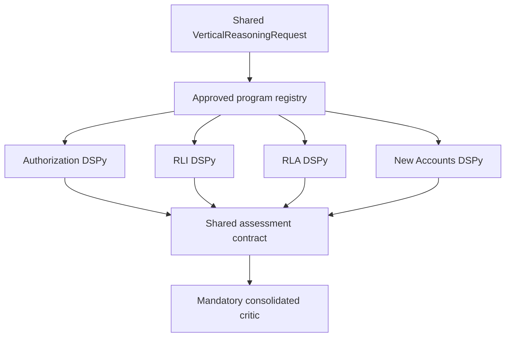

**Governance:** vertical teams may optimize internal reasoning but cannot modify global aggregation, bypass critics or fetch arbitrary sources. **Tests:** SDK contract tests, skill compatibility, per-vertical gold sets, cross-vertical regression, resource budgets.

**HLD impact:** C09 is a plugin execution runtime, not a monolithic agent. **Links:** ADR-07, ADR-11, ADR-12, ADR-14.

### v1.2 review clarification — vertical implementation governance (proposed)

**Scenario.** A new vertical uses a custom DSPy module requiring an unapproved data source. C15 validates skill/program compatibility, approved dependency locks, runtime budgets and capability allowlists before C09 execution. C09 may produce domain-specific structured findings, but C10/C11/C12/C13 retain centralized authority. A new vertical does not gain authority to define global aggregation or bypass the mandatory critic. **Tests:** incompatible skill version, unauthorized capability, invalid artifact schema. **Links:** ADR-11, ADR-14.


## ADR-07 — Adaptive vertical activation

**Opening question/scenario.** A transcript alleges both an incorrect decline and a broken servicing promise. Should we run one vertical, all verticals, or activate them based on claims and evidence?

**Architecture location:** C04/C05, C07/C09. **Status: Agreed — adaptive Option C.**

| Alternative | Advantage | Risk | Decision |
|---|---|---|---|
| Single top vertical | Cheap | Misses multi-vertical claims | Rejected |
| Run every vertical | High coverage | Expensive, noisy | Rejected |
| Candidate routing + governed adaptive activation | Balanced coverage/cost | Needs missed-vertical evaluation | **Selected** |

**Decision.** Candidate router operates at claim level; activation policy selects eligible verticals using skill definitions, confidence/ambiguity and evidence needs; dynamic planner schedules tasks. New evidence may trigger bounded additional activation. Required evidence is not inferred solely from router confidence.

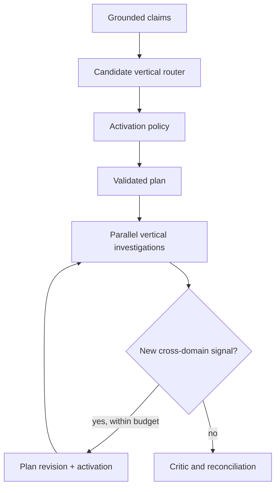

**Tests:** candidate recall, multi-vertical recall, unnecessary activation rate, per-vertical latency/cost, correct handling of claims with no eligible vertical. **Open:** exact activation thresholds.

**HLD impact:** Routing is separate from planning and execution authorization. **Links:** ADR-03, ADR-06, ADR-10, ADR-16.

### v1.2 review clarification — activation on revised claims (proposed)

**Scenario.** C02 revises the claim set after evidence retrieval, making a new vertical relevant. C04 must rerun candidate coverage for affected claims; C05 checks the active plan against current claim-set hash, adds or cancels bounded tasks and preserves previous plan revisions. Candidate recall and excess activation require measured thresholds, not invented constants. **Tests:** multi-vertical claim, newly discovered allegation, stale activation, budget exhaustion. **Links:** ADR-03, ADR-16.


## ADR-08 — Global configurable severity aggregation

**Opening question/scenario.** One complaint has three claims with severities 0.3, 0.7 and 0.9. Should the case severity equal the highest claim, a weighted combination, or a governed hierarchy?

**Architecture location:** C12, C13; inputs from C09/C10/C11. **Status: Agreed global configuration; numerical rubric calibration open.**

| Alternative | Strength | Risk | Decision |
|---|---|---|---|
| Maximum | Simple and preserves peak impact | May overemphasize a single outlier | Supported configuration |
| Weighted | Reflects multiple impacts | Weight calibration and duplicate impact | Supported configuration |
| Governed hierarchical | Encodes business priority and dependencies | More policy complexity | Supported configuration |
| Per-vertical case strategy | Flexible locally | Inconsistent case semantics | Rejected |

**Decision.** Exactly one approved severity aggregation strategy is active globally. Vertical-specific rubrics generate claim-level factors and scores; C12 combines them according to the pinned global strategy. C11 supplies duplicate-impact relationships so weighted/hierarchical strategies do not double-count shared harm.

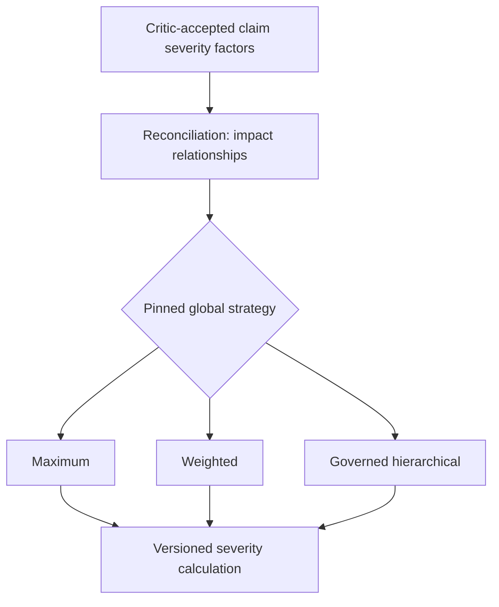

**Contracts:** `SeverityFactor`, `ClaimSeverity`, `ImpactRelationship`, `SeverityAggregationConfig`, `SeverityCalculation`. **Tests:** deterministic replay, duplicate impacts, edge values, cross-vertical calibration and score range. **Open:** weights, hierarchy and thresholds need business approval.

**HLD impact:** C12 owns case aggregation; vertical agents cannot choose it. **Links:** ADR-09, ADR-10, ADR-16, ADR-17.

### v1.2 review clarification — calibrated severity and duplicate impact (proposed)

**Scenario.** Two verticals assign severity to the same financial loss. C11 records overlap/derived-from relationships; C12 applies the pinned global maximum, weighted or hierarchical policy and an explicit impact deduplication rule. Weighted and hierarchical strategies must not be enabled without approved cross-vertical calibration, weight definitions, missing-value semantics and reproducible calculation artifacts. A numerical 0 is not a substitute for incomplete or not-applicable severity. **Open:** approved severity scale calibration and duplicate-impact policy. **Links:** ADR-09, ADR-10, ADR-17.


## ADR-09 — Claim-level error findings, dual severity and global B1/B2

**Opening question/scenario.** A customer reports a serious problem, but the bank may not have erred. Should severity reflect the customer impact or only the confirmed error? And how do multiple claim findings become one case error?

**Architecture location:** C09/C10/C11 → C12. **Status: Agreed A3 dual severity and globally configurable B1/B2; B3 excluded.**

**Claim finding:** YES, NO, UNDETERMINED. **Severity perspectives:** (1) complaint impact regardless of confirmed error; (2) impact attributable to confirmed Amex-error claims. Both on 0–1 scales and both use the selected global severity strategy, subject to applicability/completeness rules.

| Error policy | Logic | Main trade-off |
|---|---|---|
| B1 — `any_confirmed_error` | YES if any accepted material claim is YES; NO only if all relevant claims conclusively NO; otherwise UNDETERMINED | Captures secondary errors; may not reflect principal allegation |
| B2 — `primary_claim` | Case finding follows validated primary claim | Focuses on principal issue; can be NO despite secondary YES |
| B3 | Explicitly not supported | — |

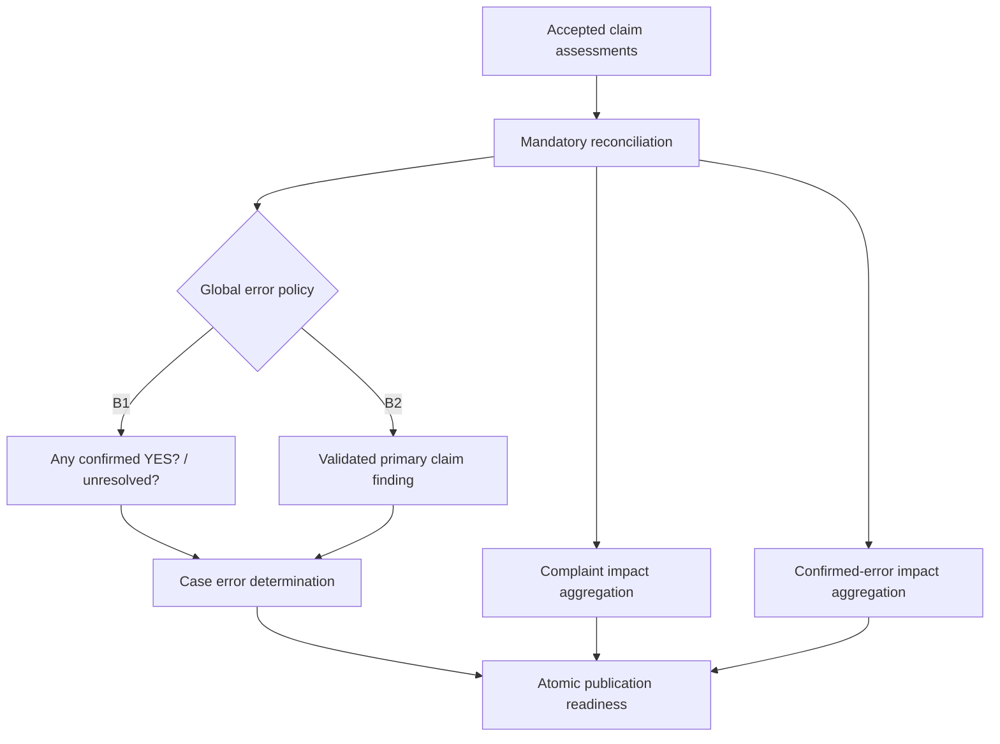

**Important:** UNDETERMINED must not silently become NO. Secondary YES remains visible under B2 even if case NO. **Tests:** all truth-table combinations, primary claim absent, unresolved claims, severity not-applicable vs unknown, impact deduplication.

**HLD impact:** Separates error classification from severity and prevents LLM-written case scores. **Links:** ADR-08, ADR-10, ADR-16, ADR-17.

### v1.2 review clarification — B2 and confirmed-error severity are different scopes (proposed)

**Scenario.** B2 selects primary NO while a secondary claim has accepted YES. The **case error remains NO** under B2, but that does not prove the case has no confirmed Amex-error impact. C12 must calculate the confirmed-error severity according to the approved scope of eligible confirmed-error claims; it must not automatically set `NOT_APPLICABLE` or zero based solely on B2 case NO. The precise eligibility and `NOT_APPLICABLE` business rule remain **OPEN**.

| Claim findings | B1 error | B2 error (primary first) | Confirmed-error severity treatment |
|---|---|---|---|
| Primary NO; secondary YES | YES | NO | Evaluate secondary confirmed-error impact; do not auto-NA |
| Primary YES; secondary unresolved | YES | YES | May be incomplete if unresolved impact could change score |
| Primary NO; secondary unresolved | INDETERMINATE | NO | Independently evaluate severity readiness; unresolved is not zero |
| All accepted NO | NO | NO | `NOT_APPLICABLE` only if approved rule permits |

**Links:** ADR-08, ADR-16, ADR-17.


## ADR-10 — Central case state, isolated vertical contexts, mandatory reconciliation

**Opening question/scenario.** Two vertical agents use overlapping customer evidence but have different tasks. How can they reason independently, avoid cross-contamination, and still detect inconsistent findings before case aggregation?

**Architecture location:** C14/C09/C11, with C05/C06 for reassessment. **Status: Agreed — fully isolated context (Option C), assessments + referenced evidence (reconciliation Option B), always-on reconciliation (Option A).**

| Design option | Benefit | Risk | Decision |
|---|---|---|---|
| Shared conversational context | Easy sharing | Cross-vertical leakage, weak provenance | Rejected |
| Fully isolated vertical context | Controlled reasoning and privacy | Requires reconciliation | **Selected** |
| Reconciliation on summaries only | Low cost | Cannot verify source meaning | Rejected |
| Reconciliation on assessments + governed evidence refs | Traceable cross-claim checks | More access governance | **Selected** |
| Conditional reconciliation | Less overhead | Inconsistent quality boundary | Rejected |
| Always invoke reconciliation | Uniform gate | Added latency | **Selected**, with adaptive semantic depth |

**State model.** C14 owns versioned claims, evidence, assessments, critic results, reconciliation, decisions. Each C09 context package is an immutable authorized projection. Agents cannot mutate authoritative state. Reconciler can resolve only referenced evidence and permitted relationship artifacts; new evidence requests go to C05.

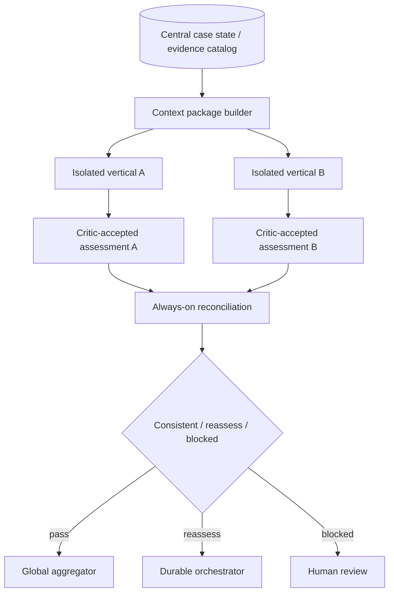

**Reconciliation checks:** evidence consistency, contradictory findings, claim dependencies, duplicate impacts, missing material evidence, readiness. A valid authorization decline and incorrect servicing explanation can both be true: disagreement in labels is not automatically a contradiction.

**Result contract:** `ReconciliationRequest` (accepted assessment set, evidence refs, claim relationships, snapshot/policy version) and `ReconciliationResult` (`PASSED`, `REASSESSMENT_REQUIRED`, `BLOCKED`; issues; typed actions; provenance). Immutable revisions; no direct override of vertical findings.

**Tests:** single-vertical gate, conflicting policy versions, duplicate loss, denied evidence access, targeted reassessment, bounded loops, idempotent result commit.

**HLD impact:** C11 is a mandatory barrier between accepted assessments and C12. **Links:** ADR-11, ADR-12, ADR-15, ADR-17.

### v1.2 review clarification — reconcile dispositions, not just accepted assessments (proposed)

**Scenario.** One vertical never produces a critic-accepted assessment because LUMI is unavailable. ADR-10 still requires reconciliation. C14 builds an immutable `ClaimDispositionManifest` enumerating every material claim and whether it has an accepted conclusive assessment, accepted undetermined assessment, unresolved/no accepted assessment, pending work or review obligation. C11 reconciles this manifest **plus** accepted assessments and authorized referenced evidence. A `PASSED` report can include explicitly nonblocking unresolved claims; it cannot mean every claim is conclusive. C11 cannot fabricate an assessment or declare severity complete.

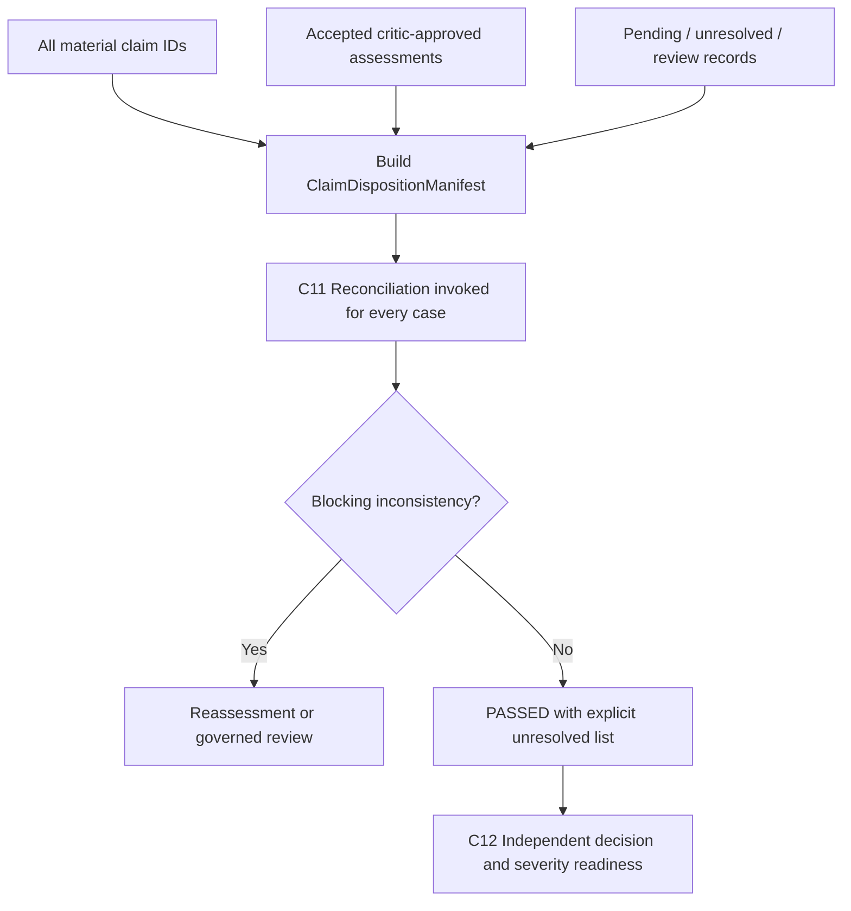

**Tests:** missing accepted assessment, accepted UNDETERMINED, changed assessment set requiring new reconciliation revision, no material claims. **Links:** ADR-11, ADR-16, ADR-17.


## ADR-11 — Always-on single consolidated critic

**Opening question/scenario.** A vertical assessor cites a customer statement as proof of a technical system error. Who challenges the unsupported inference before the case result is trusted?

**Architecture location:** C09 → C10 → C14/C11. **Status: Agreed — one consolidated critic and always-on invocation.**

| Option | Advantage | Disadvantage | Decision |
|---|---|---|---|
| Single consolidated critic | Simpler, lower orchestration overhead | Risk of superficial checks | **Selected** |
| Multiple specialized critics | Targeted checks | More calls, conflicting feedback | Not selected |
| Hybrid specialized critics | Flexible | Added platform complexity | Not selected |
| Conditional critic | Lower latency | Some proposals unreviewed | Rejected |

**Five mandatory dimensions:** evidence sufficiency, policy applicability, temporal consistency, reasoning validity, severity justification. `NOT_APPLICABLE` permitted for an individual dimension when justified. Deterministic schema, evidence ID, authorization and version checks stay outside the LLM.

**Critique mode:** direct critique (selected later in ADR-15). Critic sees proposal and full authorized vertical evidence, verifies cited propositions, checks counterevidence, and may accept alternative evidence within hard constraints. It is **not** a second independent classifier.

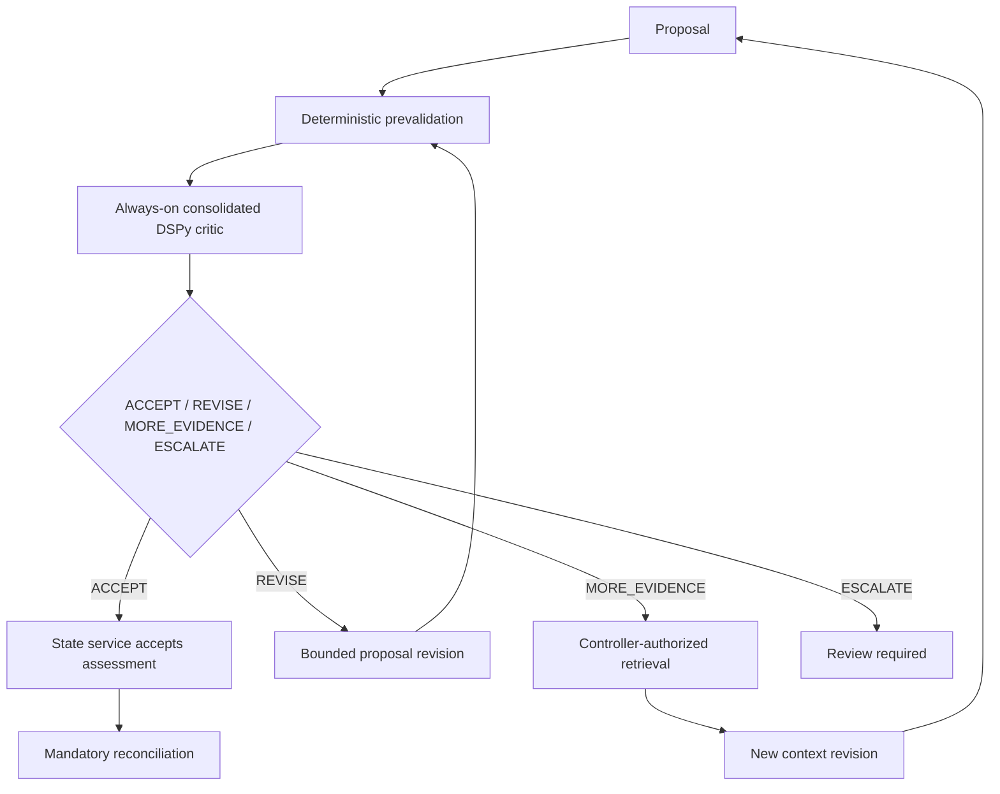

**Budgets:** separate proposal revisions, evidence expansions, technical retries, model calls and deadlines; initial prototype values discussed were two revisions/two evidence expansions, **not** approved production limits. Critic failure never implies approval. **Tests:** unsupported YES/NO detection, false rejection, evidence substitution precision, revision success, no-progress loops, timeout recovery.

**HLD impact:** Accepted assessment commits require a matching ACCEPT critic result for the exact proposal revision and input hash. **Links:** ADR-10, ADR-12, ADR-15.

### v1.2 review clarification — strict critic authority (proposed)

**Scenario.** A critic accepts a persuasive substitute source but an applicable hard evidence requirement is unsatisfied. C10 owns **semantic sufficiency and proposal verdict only**; deterministic C14 acceptance validation checks evidence references, approved authority tiers, temporal/source scope, immutable proposal hash, and non-waivable requirements. Critic `ACCEPT` alone is never a business commit. `FAILED_RETRYABLE` is not `UNDETERMINED`; no timeout is treated as approval. Protected adversarial tests must cover persuasive but weak substitutes and fabricated citations. **Links:** ADR-10, ADR-15.


## ADR-12 — Typed execution contracts, bounded DSPy and structured persistence

**Opening question/scenario.** A DSPy assessor runs several reasoning steps, the critic times out, and the worker restarts. How do we resume without rerunning every previous stage or losing the audit trail?

**Architecture location:** C05/C06/C09/C10/C14/C15. **Status: Agreed bounded internal DSPy (Option B), structured intermediate artifacts (Option B); Temporal preferred candidate.**

**Runtime alternatives:** LangGraph-centric (agent graph/checkpointing), Temporal-centric (durable workflow with DSPy activities), or Temporal + LangGraph (two runtime/state layers). We preferred **Temporal-centric with DSPy directly**, pending enterprise approval; introduce LangGraph only for demonstrated subgraph needs.

**Vertical execution alternatives:** single inference, bounded internal multi-step DSPy, or independently checkpointed agent subgraph. We chose bounded internal reasoning: internal stages may use Predict, ChainOfThought or RLM, but external retrieval and durable transitions remain orchestrator-controlled.

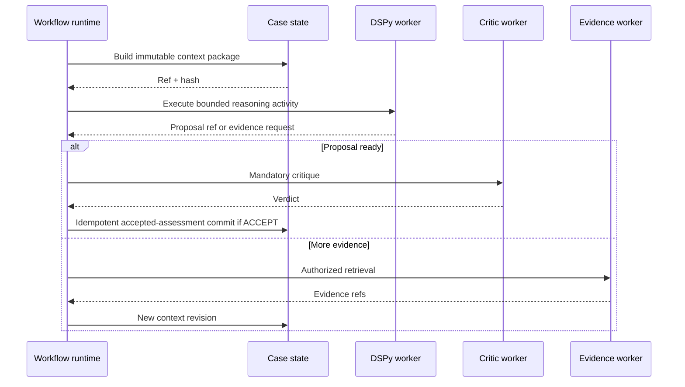

**Execution envelope:** case/run/task IDs, capability and version, input refs/hash, deadline, idempotency key, trace ID, authorization context and budget. **Task status:** success, retryable failure, permanent failure, cancellation. A business-level `MORE_EVIDENCE_REQUIRED` is a successful activity outcome, not a technical failure.

**Persistence choice:** structured findings, policy interpretations, severity factors, proposal revisions, critic/reconciliation results, execution metadata. Avoid unrestricted chain-of-thought, RLM scratchpads or raw prompts in routine audit/telemetry. Workflow histories carry compact artifact refs; business state and immutable object artifacts live separately.

**Replay:** workflow recovery, decision reconstruction, evidence-frozen evaluation and fresh-evidence reprocessing are distinct. LLM execution is not exactly-once; business artifact commitment must be idempotent.

**Tests:** crash mid-reasoning, crash after object upload, retry before/after commit, version pinning, schema mismatch, trace correlation and deterministic aggregation replay.

**HLD impact:** Defines C06/C14 ownership boundary and prevents the agent framework from becoming a second uncontrolled orchestrator. **Links:** ADR-10, ADR-11, ADR-13, ADR-14.

### v1.2 review clarification — retries, manifests and state separation (proposed)

**Scenario.** A Temporal activity completes a model call and writes an artifact, then crashes; a retry produces a different answer. Preserve attempt-level artifacts and apply an explicit **first-valid-commit-wins** logical-task policy (candidate design) with uniqueness on `(logical_task_id, input_hash, program_version, plan_revision)`. Conflicting later attempts are audited, not silently overwritten. Use an immutable execution manifest that binds program, skill, model, retrieval/index, scoring and schema versions; validate dependencies before admission. Workflow history is not the authoritative case-state database.

```mermaid
sequenceDiagram
  participant T as C06 Workflow
  participant W as DSPy Worker
  participant O as Artifact Store
  participant S as C14 Case State
  T->>W: Execute task, pinned manifest
  W->>O: Write immutable attempt artifact
  W->>S: Commit logical task result with idempotency key
  alt First valid result
    S-->>W: Committed artifact reference
  else Identical retry
    S-->>W: Return existing reference
  else Different retry result
    S-->>W: Conflict; preserve attempt for audit
  end
  W-->>T: Stable committed result reference
```

**Tests:** concurrent retries, worker crash after upload, stale artifact reference, retired index generation, rollback during active batch. **Links:** ADR-13, ADR-14, ADR-17.


## ADR-13 — Cloud-agnostic infrastructure and 8-hour scheduled batch capacity

**Opening question/scenario.** Up to 100,000 complaints arrive in scheduled batches that must be processed in eight hours, while real-time requirements remain undecided. How should we host and size the system without knowing the enterprise-approved platform?

**Architecture location:** C01/C06/C09/C14/C15/C17. **Status: Agreed logical topology and workload assumptions; hosting products, SLAs and quotas open.**

| Alternative | Benefit | Trade-off | Position |
|---|---|---|---|
| GCP-managed services | Natural BigQuery integration | Enterprise service approval and coupling | Candidate |
| Enterprise Kubernetes | Flexible workers and isolation | Operations burden | Candidate |
| Existing enterprise workflow platform | Standardized controls | Must prove dynamic workflow semantics | Candidate |
| Cloud-agnostic contracts + portable containers | Avoid premature selection | Not zero-cost portability | **Selected logical approach** |

**Logical stores:** workflow persistence; relational authoritative case state; immutable object artifacts; independent retrieval indexes; LUMI/BigQuery authoritative customer source; registries; telemetry. PostgreSQL, object-store vendor and Temporal hosting remain candidates.

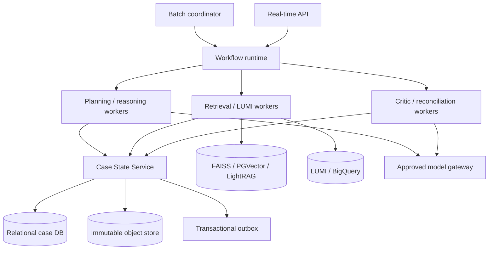

**Sizing arithmetic:** 100,000/28,800 s = **3.47 completed cases/s** minimum. A +50% throughput headroom scenario is **5.21 cases/s**; at ideal sustained rate it would take ~5.33 hours. With illustrative 12 model calls/case, upper batch = 1.2 million calls, averaging 41.7 calls/s over eight hours; at 5-second mean call latency ~209 concurrent calls at minimum throughput, ~313 at +50% capacity. These are **not measured** workload statistics. Token quotas may be the binding constraint.

**Isolation:** separate batch/real-time task queues, worker capacity and model quotas; queues alone do not guarantee isolation. **Recovery:** RPO/RTO open, idempotent state commits, source backpressure, backlog drain tests. **Eight-hour reporting:** distinguish processing disposition, decision publication and investigation completion.

**Tests:** 100k-workflow batch, 8-hour deadline, model quota saturation, 2-hour outage recovery, source throttling, storage consistency, worker failover. **HLD impact:** no arbitrary replica counts before benchmarking. **Links:** ADR-01, ADR-12, ADR-14, ADR-17.

### v1.2 review clarification — three batch outcome SLOs (proposed)

**Scenario.** All 100,000 workflows reach `REVIEW_REQUIRED` in eight hours but no decisions are published. This meets a processing-disposition count, **not** a decision-publication SLO. C01/C06/C17 must report independently: (1) durable processing disposition within eight hours, (2) atomic publication count/rate/latency, and (3) investigation completion/follow-up. The 3.47 cases/sec minimum and 5.21 cases/sec headroom scenario apply to the explicitly named numerator; never equate dispositions with finalized decisions. Real-time SLA, RPO/RTO, quotas and platform remain open. **Tests:** review storm, source outage, two-hour batch disruption, model quota saturation. **Links:** ADR-16, ADR-17.


## ADR-14 — Federated DSPy optimization with centrally governed flexible programs

**Opening question/scenario.** Authorization and RLI teams need to optimize different reasoning programs, but a new optimized prompt must not silently change approved business rules or destabilize production batches. Who owns development, datasets and release authority?

**Architecture location:** C09/C15/C16/C17; affects C06 release pinning. **Status: Agreed federated optimization (B), flexible internal DSPy (B), central governance.**

| Alternative | Advantage | Risk | Decision |
|---|---|---|---|
| Central team owns all optimization | Uniform control | Bottleneck and weak domain ownership | Rejected |
| Federated domain optimization + central gates | Domain expertise + standards | Requires clear RACI | **Selected** |
| Fully decentralized | Fast local iteration | Inconsistent quality and governance | Rejected |
| Identical DSPy template for all verticals | Uniform implementation | Restricts domain reasoning | Rejected |
| Flexible programs behind shared contracts | Best specialization | Compatibility testing needed | **Selected** |

**Ownership:** domain owners curate skills, examples, domain datasets and vertical programs; platform owns SDK, shared programs, contracts, registries and execution; independent quality/model governance reviews evaluation and policy; operations deploys and monitors. Global B1/B2 and severity strategies cannot be changed by vertical teams.

**Dataset model:** central catalog, federated curation, protected held-out tests, adjudicated labels, case/group-level leakage prevention, data-use approvals. **Program tiers:** shared understanding/planner, independent vertical assessors, shared critic/reconciler. **Optimizers:** benchmark suitable DSPy approaches (e.g., BootstrapFewShot, MIPROv2, GEPA) against pinned-version compatibility; not an unconditional optimizer mandate.

```mermaid
flowchart TD
  A[Domain owner candidate program] --> B[Offline DSPy optimization]
  B --> C[Module evaluation]
  C --> D[Vertical + cross-vertical regression]
  D --> E[End-to-end evaluation]
  E --> F{Quality, security, business approval}
  F -->|reject| A
  F -->|approve| G[Immutable program registry]
  G --> H[Shadow execution]
  H --> I[Controlled canary]
  I --> J[Approved production release manifest]
```

**Registry separation:** Vertical Skill Registry = business rules, examples and severity rubrics; DSPy Program Registry = executable program/optimized state/model/dependencies; release manifest pins compatible versions and checksums. Batch admission pins the catalog for all case workflows in that batch.

**Tests:** protected evaluation, FP/FN by vertical, contract compatibility, model upgrade regression, shadow parity, rollback, optimization job isolation. **Open:** numeric promotion thresholds and actual governance roles.

**HLD impact:** C16 is an offline platform; no production self-optimization. **Links:** ADR-06, ADR-11, ADR-12, ADR-13.

### v1.2 review clarification — release manifest and protected evaluation (proposed)

**Scenario.** A vertical's optimized program is compatible with its skill but incompatible with the deployed critic contract or a retired policy index. C15 should publish one content-addressed release manifest with a dependency/compatibility graph, exact hashes and approval records. New workflows resolve the approved manifest at admission; existing workflows remain pinned unless governed migration occurs. C16 must enforce case/customer-group-level split integrity, independent held-out tests and data-use permissions. Rollback changes the new-admission mapping; it does not mutate in-flight cases or previously published decisions. **Tests:** incompatible versions, leaked evaluation groups, retired dependency, rollback mid-batch. **Links:** ADR-12, ADR-15.


## ADR-15 — Fixed retrieval strategies, source-aware freshness, critic-controlled sufficiency

**Opening question/scenario.** The expected authorization event is missing, but an authoritative incident record may establish the cause. How can retrieval remain reproducible while allowing a critic to judge equivalent evidence without bypassing mandatory policy?

**Architecture location:** C07/C08/C10/C11/C14/C15. **Status: Agreed fixed strategy (A), source-aware freshness (C), critic-controlled sufficiency (C), direct critique (A).**

**Retrieval strategy alternatives:** one fixed strategy per capability (selected), configurable strategy per request, dynamic strategy routing. Fixed means **version-pinned approved strategy**, not one backend. A hybrid capability can query multiple backends with approved fusion. Backends remain replaceable through versioned releases.

**Freshness alternatives:** all sources pinned, always latest, or source-aware. **Selected source-aware:** knowledge indexes pinned by generation; policies filtered by effective date; LUMI structured facts queried with event-time/observation-time semantics where supported; actual source observations snapshotted. Current-only facts cannot be represented as verified history.

**Sufficiency alternatives:** strict blocking, governed prelisted substitutions, critic-controlled sufficiency. **Selected critic-controlled** for substitutable expected evidence; deterministic validator enforces non-waivable hard requirements, authorized evidence refs and consistent outcomes.

**Critic mode alternatives:** direct critique (selected), independent evidence-first, dual critics. Direct critique sees the proposal and full authorized evidence; it must verify each cited proposition, examine counterevidence, and challenge missing or weak support. It does not create a second full classification.

```mermaid
flowchart TD
  A[Planner requests logical capability] --> B[Pinned capability + strategy]
  B --> C[Backend adapter(s)]
  C --> D[Normalize, dedupe, source resolve]
  D --> E[Temporal/provenance validation]
  E --> F[Deterministic coverage report]
  F --> G[Vertical proposal]
  G --> H[Mandatory direct critic]
  H --> I{Semantic sufficiency}
  I -->|supported| J[Deterministic hard-constraint validation]
  I -->|missing| K[Bounded retrieval request]
  I -->|conflict| L[Review / reassess]
  J --> M[Accepted assessment]
```

**Evidence requirement classes:** `hard`, `expected`, `preferred`; conditional requirements activated by approved predicates. **Coverage statuses:** SATISFIED, PARTIAL, NOT_FOUND, UNAVAILABLE, INVALID, NOT_APPLICABLE, NOT_ATTEMPTED. A successful empty search does not prove absence of an error. **Semantic sufficiency** is distinct from deterministic source coverage.

**Alternative evidence evaluation:** authority, specificity, temporal validity, directness, completeness. A critic can accept an approved incident record as an alternative to an unavailable event log if it establishes the same proposition and no hard constraint is violated; it cannot treat a customer's allegation as independent verification of technical cause. Persist `EvidenceSubstitutionRecord` with missing requirement, alternative IDs, proposition, justification, program/version and critic verdict.

**Index lifecycle:** source snapshot → chunking/embeddings/graph generation → quality validation → immutable index generation → promotion → pinned retrieval release. **Replay:** reconstruct original evidence-frozen decision or start linked fresh-evidence reprocessing; never overwrite original decision.

**Tests:** recall@k, required coverage, temporal policy applicability, invalid citations, partial/fallback semantics, substitution precision, false acceptance, historical LUMI source support. **Open:** exact source refresh SLOs and approved hard-requirement inventory.

**HLD impact:** C08 gates readiness to reason, C10 judges semantic sufficiency, C11 judges cross-claim readiness. **Links:** ADR-02, ADR-05, ADR-10, ADR-11, ADR-17.

### v1.2 review clarification — temporal evidence and substitution conformance (proposed)

**Scenario.** A policy is retroactively corrected, while a LUMI record is only current-state. C07/C08 must distinguish business valid time, source recorded/observed time, retrieval time, correction/supersession, index generation and temporal quality. C10 may semantically accept alternative evidence only for substitutable expected requirements; C14 validates non-waivable requirements and resolvable authorized source references. An index pin is **not** a batch-wide snapshot of mutable BigQuery data. Backend conformance tests must verify effective-time filters and source citations. **Open:** source-history capability and approved hard-requirement inventory. **Links:** ADR-02, ADR-11.


## ADR-16 — DSPy primary selection (P2) and decision-aware finalization (F2)

**Opening question/scenario.** A customer makes three allegations, one is primary, another is a confirmed Amex error, and a third remains unresolved. How should global B2 decide the case, and can a case decision be final before every allegation is closed?

**Architecture location:** C03, C12, C13, C18. **Status: Agreed P2 + F2.**

**Primary selection alternatives:** P1 source-defined, P2 DSPy-selected (**selected**), P3 source-first/DSPy fallback. The selector runs after grounding and **before** classification or severity; selection must not be biased by likely YES/NO or impact. Output: SELECTED, AMBIGUOUS, NO_ELIGIBLE_CLAIM, source spans, rationale, program version. B2 requires a valid primary claim; B1 does not necessarily require one.

**Finalization alternatives:** F1 strict all-claim completion, F2 decision-aware (**selected**), F3 provisional then full closure. F2 allows conclusive case-level error finalization with unresolved secondary claims if they do not undermine the configured error result and other mandatory gates pass. Investigation status remains separate from decision status.

| Strategy | Accepted findings | Error result | Decision-aware interpretation |
|---|---|---|---|
| B1 | YES, UNDETERMINED | YES | Error conclusive; secondary investigation incomplete |
| B1 | NO, UNDETERMINED | UNDETERMINED | Cannot finalize error |
| B2 | Primary NO, secondary YES | NO | Case-level NO; secondary YES must remain visible |
| B2 | Primary YES, secondary UNDETERMINED | YES | Error conclusive if no blocking dependency |
| B2 | Primary UNDETERMINED, secondary YES | UNDETERMINED | Cannot finalize error |

```mermaid
flowchart TD
  A[Pass 2 grounded claims] --> B[DSPy primary selector]
  B --> C[Validate eligibility + spans]
  C --> D[Routing, evidence, assessment, critics]
  D --> E[Mandatory reconciliation]
  E --> F[Deterministic B1/B2 readiness]
  F -->|conclusive| G[Global error determination]
  F -->|not conclusive| H[Review / reassessment]
  G --> I{Unresolved secondary claims?}
  I -->|yes| J[Record follow-up obligations]
  I -->|no| K[Investigation complete]
  J --> L[Atomic publication readiness]
  K --> L
```

**State model:** `decision_status` (PENDING/FINALIZED/REVIEW_REQUIRED) separate from `investigation_status` (IN_PROGRESS/COMPLETE/FOLLOW_UP_REQUIRED). **Critical qualification:** ADR-17 additionally requires severity publishability; F2 error conclusiveness alone is insufficient to publish.

**Tests:** primary selection accuracy, ambiguous primary, B1/B2 truth tables, unresolved dependencies, secondary positive retention, durable follow-up creation. **HLD impact:** C03 and C18 become explicit components. **Links:** ADR-03, ADR-07, ADR-09, ADR-17.

### v1.2 review clarification — orthogonal statuses and human review (proposed)

**Scenario.** B2 primary NO is conclusive while a secondary claim is unresolved, and the primary selection is later invalidated by a revised claim set. C03 selection must be bound to current `claim_set_hash`. C18 should own typed `ReviewRequest`, `ReviewDisposition`, reviewer authority, approval timestamps, follow-up obligations and linked reprocessing; it cannot silently overwrite published decisions. Model **decision**, **investigation**, **workflow** and **publication** as separate state dimensions (Part IV.4). F2 permits error conclusiveness without full investigation completion; ADR-17 independently gates severity and publication. **Open:** unresolved-impact materiality policy. **Links:** ADR-03, ADR-09, ADR-17.


## ADR-17 — Atomic error and dual-severity publication

**Opening question/scenario.** The Amex-error result is conclusive, but complaint-impact severity is still materially uncertain because of an unresolved secondary allegation. Can downstream consumers receive the error field now and the severity later?

**Architecture location:** C12/C13/C14/C18. **Status: Agreed atomic publication Option A; materiality/completeness semantics open.**

| Alternative | Benefit | Risk | Decision |
|---|---|---|---|
| Publish error and severity independently | Early availability | Downstream inconsistent snapshots | Rejected |
| Publish only one complete versioned result | Consistent consumer semantics | May delay output | **Selected** |

**Decision.** Publish error finding and both severity perspectives together from one accepted assessment-set snapshot, after critic/reconciliation, global aggregation and deterministic readiness. Severity states: FINAL (0–1), NOT_APPLICABLE (null with approved reason), INCOMPLETE and CONFLICTED (block). A conclusive case error with nonblocking unresolved claims may still fail publication if those claims could materially alter either required severity perspective.

```mermaid
sequenceDiagram
  participant W as Workflow
  participant R as Reconciler
  participant D as Decision engine
  participant S as Case State DB
  participant O as Outbox publisher
  participant C as Consumer
  W->>R: Validate accepted assessment set
  R-->>W: PASSED + reconciliation ref
  W->>D: B1/B2 + dual severity
  D-->>W: Calculation refs + readiness
  alt All atomic gates pass
    W->>S: Transaction: immutable decision + outbox row
    S-->>W: Committed decision revision
    O->>S: Poll pending outbox
    O->>C: Publish versioned result (at-least-once)
    C-->>O: Acknowledge / dedupe
  else Missing or conflicted severity
    W->>W: Reassess / review; do not publish
  end
```

**Contracts:** `PublishedCaseDecision`, `PublishedSeverity`, `DecisionReadiness`, `PublicationOutboxEvent`; immutable calculation refs and policy manifest. Atomicity is at **database commit**; external event delivery is at-least-once and must be idempotently consumed. Corrections create linked decision revisions.

**Open critical rule:** define when unresolved secondary impact is demonstrably non-material to both severity scores, and exact `NOT_APPLICABLE` semantics (including no confirmed error versus unknown impact). Do not invent defaults.

**Tests:** decision+outbox transactional failure, duplicate delivery, missing severity, stale assessment revision, follow-up after publication, immutable correction lineage. **HLD impact:** C13 is a hard publication gate, not a formatting stage. **Links:** ADR-08/09/10/16.

### v1.2 review clarification — atomic publication is a four-gate decision (proposed)

**Scenario.** Reconciliation passes and B1 returns YES, but an unresolved secondary allegation may increase complaint-impact severity. C13 must **not** publish based solely on a conclusive error. Require (1) reconciliation `PASSED` on the current disposition snapshot; (2) deterministic B1/B2 decision `CONCLUSIVE`; (3) **each** severity perspective `FINAL` or valid `NOT_APPLICABLE`; (4) all audit references and follow-up obligations committed against the same snapshot. `INCOMPLETE` and `CONFLICTED` block. The **business materiality rule** and exact `NOT_APPLICABLE` conditions are **OPEN**, not silently defined here. The DB decision and outbox row commit atomically; external delivery is at-least-once, with consumer dedupe key `(case_id, decision_revision)`.

```mermaid
flowchart TD
  A[C11 PASSED on current disposition snapshot] --> B[C12 Error readiness]
  B -->|CONCLUSIVE| C[C12 Complaint-impact severity readiness]
  B -->|INDETERMINATE or BLOCKED| X[No publication; review or reassess]
  C -->|FINAL or approved NA| D[C12 Confirmed-error severity readiness]
  C -->|INCOMPLETE or CONFLICTED| X
  D -->|FINAL or approved NA| E[C13 Snapshot and audit validation]
  D -->|INCOMPLETE or CONFLICTED| X
  E -->|valid| F[C14 Transaction: decision and outbox]
  E -->|stale or invalid| X
  F --> G[At-least-once event delivery with consumer dedupe]
```

**Tests:** B2 primary NO/secondary YES, unresolved material severity, stale snapshot, duplicate outbox delivery, NA without approved reason. **Links:** ADR-08, ADR-09, ADR-10, ADR-16.


# Part III — Consolidated architecture views

## III.1 Component view and boundaries

```mermaid
flowchart LR
  subgraph Control[Control plane]
    IN[C01 Intake]
    WF[C06 Durable runtime]
    PL[C05 Planner + controller]
    IN --> WF --> PL
  end
  subgraph Intelligence[Reasoning plane]
    U[C02 Understanding]
    PC[C03 Primary selector]
    RO[C04 Router]
    V[C09 Vertical DSPy/RLM]
    CR[C10 Critic]
    RE[C11 Reconciler]
    U --> PC --> RO --> V --> CR --> RE
  end
  subgraph Evidence[Evidence plane]
    RET[C07 Retrieval]
    COV[C08 Coverage]
    RET --> COV
  end
  subgraph State[Business state plane]
    CS[C14 Case state]
    AR[C15 Artifacts/registries]
  end
  subgraph Decision[Decision plane]
    AG[C12 Aggregator]
    PUB[C13 Publication]
    FU[C18 Follow-up]
    AG --> PUB --> FU
  end
  PL --> U
  PL --> RET
  COV --> V
  RE --> AG
  V <--> CS
  RET <--> CS
  CR <--> CS
  PUB <--> CS
  AR -. pinned versions .-> WF
```

**Boundary rules:** workflow state ≠ business state; source index ≠ authoritative evidence; vertical context ≠ shared case state; critic ≠ reconciler; finalization ≠ investigation completion; commit ≠ downstream event delivery.

### III.1a Exclusive authority and readiness boundaries (v1.2)

| Component | Sole decision authority | Must not decide |
|---|---|---|
| C02 | Allegation/grounding revision proposals | Amex error |
| C03 | Primary selection proposal tied to claim-set hash | Primary based on severity or later findings |
| C04 | Candidate vertical list | Execute task DAG |
| C05 | Validated plans, activation and replanning | Commit unvalidated business findings |
| C06 | Durable scheduling and technical task transitions | Business truth |
| C07 | Retrieval execution and normalized source results | Semantic sufficiency |
| C08 | Deterministic coverage status | YES/NO validity |
| C09 | Proposed vertical assessment | Accept its own proposal |
| C10 | Semantic sufficiency and critic verdict | Waive hard constraints or finalize case |
| C11 | Cross-claim consistency and dependencies | Rewrite assessments or scores |
| C12 | Deterministic B1/B2 and severity calculation/readiness | Publish results or approve source validity |
| C13 | Atomic publication readiness and outbox | Infer missing impact |
| C14 | Authoritative business state commit | Plan or execute models |
| C18 | Governed human review and follow-up dispositions | Silently overwrite finalized decision |

**Readiness ownership:** C08 = retrieval coverage; C10 = vertical semantic sufficiency; C11 = case consistency; C12 = error and severity readiness; C13 = atomic publication readiness. C14 validates every commit. These are deliberately non-overlapping.


## III.2 Deployment view (cloud-agnostic logical topology)

```mermaid
flowchart TD
  subgraph Edge[Ingress zone]
    API[API gateway]
    BATCH[Batch coordinator]
  end
  subgraph Control[Application/orchestration zone]
    TEMP[Durable workflow service]
    W[Workflow workers]
  end
  subgraph Workers[Execution zone]
    DSPY[Reasoning workers]
    CRIT[Critic/reconciliation workers]
    RET[Retrieval workers]
    RLM[Restricted RLM sandbox]
  end
  subgraph Data[Data zone]
    STATE[(Relational case DB)]
    OBJECT[(Immutable artifact store)]
    INDEX[(Retrieval indexes)]
    REG[(Skill/program registry)]
  end
  subgraph External[Approved integrations]
    LUMI[(LUMI / BigQuery)]
    MODEL[Enterprise model gateway]
    SOURCE[Source APIs]
  end
  API --> TEMP
  BATCH --> TEMP
  TEMP <--> W
  W --> DSPY
  W --> CRIT
  W --> RET
  DSPY --> RLM
  DSPY --> MODEL
  CRIT --> MODEL
  RET --> LUMI
  RET --> SOURCE
  RET --> INDEX
  DSPY --> OBJECT
  W --> STATE
  W --> REG
  W --> OBJECT
```

**Hosting alternatives:** managed Temporal, self-hosted Temporal, or an approved equivalent workflow platform. Compute may be Kubernetes, managed containers or enterprise compute. Actual network boundaries, identities, data residency, RPO/RTO and database technology require platform approval.

## III.3 Domain ER diagram (logical schema)

```mermaid
erDiagram
  CASE ||--o{ CASE_RUN : has
  CASE ||--o{ CLAIM : contains
  CASE_RUN ||--o{ TASK_EXECUTION : schedules
  CLAIM ||--o{ GROUNDING_REVISION : grounded_by
  CLAIM ||--o{ VERTICAL_ASSESSMENT : assessed_by
  CASE_RUN ||--o{ PRIMARY_SELECTION : chooses
  CASE_RUN ||--o{ RETRIEVAL_EXECUTION : retrieves
  RETRIEVAL_EXECUTION ||--o{ RETRIEVAL_HIT : returns
  EVIDENCE ||--o{ RETRIEVAL_HIT : appears_in
  EVIDENCE ||--o{ CLAIM_EVIDENCE_LINK : supports
  CLAIM ||--o{ CLAIM_EVIDENCE_LINK : cites
  VERTICAL_ASSESSMENT ||--o{ CRITIC_RESULT : reviewed_by
  CRITIC_RESULT ||--o{ EVIDENCE_SUBSTITUTION : documents
  CASE_RUN ||--o{ RECONCILIATION_RESULT : reconciled_by
  CASE_RUN ||--o{ CASE_DECISION : produces
  CASE_DECISION ||--|{ SEVERITY_CALCULATION : contains
  CASE_DECISION ||--o{ PUBLICATION_OUTBOX : publishes
  CASE_RUN ||--o{ FOLLOWUP_OBLIGATION : tracks
  ARTIFACT ||--o{ EVIDENCE : backs
  RELEASE_MANIFEST ||--o{ CASE_RUN : pinned_by
```

**Relational guidance:** append immutable revisions; use foreign keys or validated references; `CASE_RUN` is the unit of reprocessing; keep transcript and large evidence bytes in object storage; maintain content hashes and source generations. Do not equate logical ER relationships with an immediate need for a graph database.

### III.3a Reviewed disposition, readiness and publication ER extension

```mermaid
erDiagram
  CASE ||--o{ CASE_RUN : executes
  CASE_RUN ||--o{ CLAIM_SET_REVISION : versions
  CLAIM_SET_REVISION ||--o{ PRIMARY_SELECTION : selects
  CASE_RUN ||--o{ CLAIM_DISPOSITION_MANIFEST : snapshots
  CLAIM_DISPOSITION_MANIFEST ||--o{ CLAIM_DISPOSITION : enumerates
  CLAIM ||--o{ CLAIM_DISPOSITION : has
  CLAIM_DISPOSITION }o--o| VERTICAL_ASSESSMENT : references
  VERTICAL_ASSESSMENT ||--o{ CRITIC_RESULT : reviewed_by
  CLAIM_DISPOSITION_MANIFEST ||--o{ RECONCILIATION : evaluated_by
  RECONCILIATION ||--o{ DECISION_READINESS : gates
  DECISION_READINESS ||--o{ SEVERITY_READINESS : accompanies
  CASE_RUN ||--o{ PUBLISHED_DECISION : publishes
  PUBLISHED_DECISION ||--|| OUTBOX_EVENT : commits_with
  CASE_RUN ||--o{ REVIEW_REQUEST : may_require
  REVIEW_REQUEST ||--o{ REVIEW_DISPOSITION : resolved_by
```

**Cardinality note:** this is a logical model; the one-to-one decision/outbox association is a recommended logical invariant for each published revision, not a requirement for physical table shape.


## III.4 Evidence lineage view

```mermaid
flowchart TD
  T[Original transcript artifact] --> A[Allegation + span]
  A --> G[Grounded claim]
  L[LUMI observation snapshot] --> G
  P[Policy source + effective version] --> E[Evidence finding]
  H[Historical call/case] --> E
  G --> E
  E --> PR[Vertical proposal revision]
  PR --> CR[Critic verdict + substitutions]
  CR --> AC[Accepted assessment]
  AC --> RE[Reconciliation revision]
  RE --> SC[Error/severity calculation]
  SC --> D[Published decision revision]
```

## III.5 Security and trust-boundary view

```mermaid
flowchart LR
  USER[Approved ingress identity] --> API[Authenticated intake]
  API --> WF[Workflow controller]
  WF --> AUTH[Capability authorization]
  AUTH --> RET[Retrieval worker identity]
  RET --> LUMI[(LUMI / approved source)]
  WF --> CONTEXT[Scoped context resolver]
  CONTEXT --> DSPY[Bounded vertical worker]
  CONTEXT --> RLM[Sandboxed RLM]
  DSPY --> MG[Approved model gateway]
  RLM --> MG
  DSPY -. no direct LUMI credentials .- LUMI
  RLM -. no unrestricted egress .- LUMI
  WF --> STATE[(Case State Service)]
  STATE --> AUDIT[Access + mutation audit]
```

**Security controls:** least-privilege service identities, purpose-limited retrieval, protected source refs, approved egress, encryption in transit/at rest, retention/deletion controls, sandbox resource quotas, privacy-reviewed optimization datasets, redacted logs, immutable access history. **Open:** actual enterprise security policy mapping and retention periods.

### III.5a Enforceable RLM trust boundary (v1.2)

```mermaid
flowchart LR
  W[C06 Workflow / bounded task] --> S[C17 RLM sandbox]
  A[C15 Scoped immutable artifacts] --> S
  S --> G[Approved model gateway proxy]
  S --> O[Structured proposal or evidence request]
  O --> W
  S -. denied .-> X[Unrestricted network / LUMI / secrets / host filesystem]
  C[C17 quotas, kill, trace and audit] --> S
```

Sandbox requirements: no customer-source credentials; default-deny egress except controlled model proxy; resource and token ceilings; enforced termination; no direct writes to C14; explicit technical-failure status. Security team approval is outstanding.


## III.6 Multi-vertical execution and targeted reassessment sequence

```mermaid
sequenceDiagram
  participant W as Workflow
  participant P as Planner
  participant E as Evidence
  participant A as Vertical A
  participant B as Vertical B
  participant K as Critics
  participant R as Reconciler
  W->>P: Grounded claims + candidates
  P-->>W: Validated parallel plan
  par A evidence
    W->>E: A capabilities
    E-->>W: A evidence refs
    W->>A: A isolated context
    A-->>W: A proposal
    W->>K: Critique A
  and B evidence
    W->>E: B capabilities
    E-->>W: B evidence refs
    W->>B: B isolated context
    B-->>W: B proposal
    W->>K: Critique B
  end
  K-->>W: Accepted assessment refs
  W->>R: Mandatory reconciliation
  R-->>W: Objection targeting B
  W->>P: Approved targeted replan
  P-->>W: New B evidence task
  W->>E: Retrieve B missing evidence
  W->>B: New B context revision
  B-->>W: Revised proposal
  W->>K: Critique B revision
  W->>R: Reconcile updated accepted set
  R-->>W: PASSED
```

# Part IV — Contracts, governance, and operational design

## IV.1 Common execution contract (illustrative Python)

```python
from datetime import datetime
from typing import Literal
from pydantic import BaseModel, Field, model_validator

class TaskEnvelope(BaseModel):
    task_id: str
    run_id: str
    case_id: str
    capability_id: str
    capability_version: str
    input_artifact_refs: list[str]
    input_snapshot_hash: str
    release_manifest_ref: str
    authorization_context_ref: str
    idempotency_key: str
    deadline_at: datetime
    trace_id: str | None = None

class TaskResult(BaseModel):
    task_id: str
    status: Literal['SUCCEEDED', 'FAILED_RETRYABLE', 'FAILED_PERMANENT', 'CANCELLED']
    output_artifact_refs: list[str] = Field(default_factory=list)
    error_code: str | None = None
    execution_metadata_ref: str | None = None

class EvidenceRequest(BaseModel):
    claim_id: str
    capability_id: str
    purpose: str
    parameters_ref: str

class VerticalReasoningResult(BaseModel):
    status: Literal['PROPOSAL_READY','MORE_EVIDENCE_REQUIRED','UNABLE_TO_ASSESS']
    proposal_ref: str | None = None
    evidence_requests: list[EvidenceRequest] = Field(default_factory=list)
    execution_metadata_ref: str | None = None
```

All examples are conceptual HLD contracts; implementation must add discriminated unions, schema compatibility, typed capability parameters, artifact integrity and authorization checks.

## IV.2 Proposed global configuration

```yaml
global_decisioning:
  error_aggregation:
    strategy: any_confirmed_error # or primary_claim
    scope: global
  primary_claim:
    selection: dspy
    ambiguity: explicit
  severity:
    perspectives: [complaint_impact, confirmed_error_impact]
    aggregation: maximum # or weighted / governed_hierarchical
    scope: global
  finalization:
    strategy: decision_aware
  publication:
    mode: atomic_error_and_dual_severity
    require_reconciliation_passed: true
    require_critic_accepted_assessments: true

runtime:
  durable_workflow: temporal_candidate
  bounded_replanning: true
  batch_window_hours: 8
  pin_release_at_batch_admission: true

retrieval:
  selection: fixed_approved_strategy_per_capability
  source_aware_freshness: true
  preserve_evidence_snapshots: true
```

No example config is a production-approved policy until signed off. In particular, the illustrative `maximum` and `any_confirmed_error` entries are placeholders for globally governed choices, not claims that those choices were selected as active defaults.

## IV.3 Versioned release manifest

```yaml
release:
  id: cfr-v2-release-example
  contract_bundle: contracts-v2
  shared_programs:
    allegation_extractor: extractor@approved-version
    grounder: grounder@approved-version
    primary_selector: primary@approved-version
    router: router@approved-version
    planner: planner@approved-version
    critic: critic@approved-version
    reconciler: reconciler@approved-version
  verticals:
    authorization:
      skill: authorization-skill@approved-version
      program: authorization-assessor@approved-version
    rli:
      skill: rli-skill@approved-version
      program: rli-assessor@approved-version
  retrieval_release: retrieval@approved-version
  global_decision_policy: decision-policy@approved-version
  model_configs: approved-model-config-bundle
  checksum: sha256-placeholder
```

All versions and source/index generations used in a run must be resolvable later. Mid-batch release mutation is prohibited by default.

## IV.4 Orthogonal workflow, decision, investigation and publication state machines (reviewed)

**Why v1.1 changed.** The prior operational diagram used `FINALIZED --> FOLLOWUP_REQUIRED`, implying that follow-up was a successor to finalization. F2 permits both simultaneously. v1.2 represents four separate dimensions and links them through validated events rather than conflating them.

### Workflow execution state (C06)

```mermaid
stateDiagram-v2
  [*] --> ADMITTED
  ADMITTED --> UNDERSTANDING
  UNDERSTANDING --> PLANNING
  PLANNING --> RETRIEVING
  RETRIEVING --> REASONING
  REASONING --> CRITIQUING
  CRITIQUING --> REASONING: revise
  CRITIQUING --> RETRIEVING: more evidence
  CRITIQUING --> RECONCILING: dispositions assembled
  RECONCILING --> REASONING: targeted reassessment
  RECONCILING --> AGGREGATING: passed
  AGGREGATING --> PUBLICATION_CHECK
  PUBLICATION_CHECK --> DISPOSITION_RECORDED: published or review required
  DISPOSITION_RECORDED --> [*]
```

### Decision state (C12/C13/C14)

```mermaid
stateDiagram-v2
  [*] --> PENDING
  PENDING --> CONCLUSIVE_UNPUBLISHED: B1/B2 readiness passes
  PENDING --> REVIEW_REQUIRED: cannot determine safely
  CONCLUSIVE_UNPUBLISHED --> FINALIZED: both severity perspectives and publication gates pass
  CONCLUSIVE_UNPUBLISHED --> REVIEW_REQUIRED: publication blocked
  FINALIZED --> [*]
  REVIEW_REQUIRED --> [*]
```

### Investigation state (C18)

```mermaid
stateDiagram-v2
  [*] --> IN_PROGRESS
  IN_PROGRESS --> COMPLETE: all material claims resolved
  IN_PROGRESS --> FOLLOW_UP_REQUIRED: F2 permits nonblocking unresolved claims
  FOLLOW_UP_REQUIRED --> COMPLETE: reviewed and resolved
  FOLLOW_UP_REQUIRED --> REVIEW_REQUIRED: escalation
  COMPLETE --> [*]
  REVIEW_REQUIRED --> [*]
```

### Publication event state (C13)

```mermaid
stateDiagram-v2
  [*] --> NOT_ELIGIBLE
  NOT_ELIGIBLE --> READY: atomic gate passed
  READY --> COMMITTED: decision plus outbox DB transaction
  COMMITTED --> DELIVERY_PENDING
  DELIVERY_PENDING --> DELIVERED: acknowledged
  DELIVERY_PENDING --> DELIVERY_PENDING: retry idempotently
  DELIVERED --> [*]
```

**Invariant:** `decision_status=FINALIZED` may coexist with `investigation_status=FOLLOW_UP_REQUIRED`; neither status implies a successful event delivery. Published decision revisions are immutable; corrections require linked new runs/revisions.

### IV.4a Reviewed typed readiness and human-review contracts (proposed)

```python
from typing import Literal
from pydantic import BaseModel, Field

class ClaimDisposition(BaseModel):
    claim_id: str
    status: Literal[
        "ACCEPTED_CONCLUSIVE", "ACCEPTED_UNDETERMINED",
        "UNRESOLVED_NO_ACCEPTED_ASSESSMENT", "PENDING", "REVIEW_REQUIRED"
    ]
    accepted_assessment_ref: str | None = None
    reason_code: str | None = None

class ClaimDispositionManifest(BaseModel):
    case_id: str
    run_id: str
    claim_set_hash: str
    assessment_set_version: str
    dispositions: list[ClaimDisposition]
    content_hash: str

class DecisionReadiness(BaseModel):
    status: Literal["CONCLUSIVE", "INDETERMINATE", "BLOCKED"]
    error_finding: Literal["YES", "NO", "UNDETERMINED"]
    aggregation_policy_version: str
    disposition_manifest_ref: str
    blocking_issue_ids: list[str] = Field(default_factory=list)

class SeverityReadiness(BaseModel):
    perspective: Literal["COMPLAINT_IMPACT", "CONFIRMED_ERROR_IMPACT"]
    status: Literal["FINAL", "NOT_APPLICABLE", "INCOMPLETE", "CONFLICTED"]
    score: float | None = None
    applicability_reason_code: str | None = None
    calculation_ref: str | None = None
    unresolved_material_claim_ids: list[str] = Field(default_factory=list)

class ReviewRequest(BaseModel):
    case_id: str
    run_id: str
    affected_claim_ids: list[str]
    reason_code: str
    required_reviewer_role: str
    input_snapshot_hash: str

class ReviewDisposition(BaseModel):
    request_ref: str
    outcome: Literal["CONFIRM", "REASSESS", "REQUEST_EVIDENCE", "ESCALATE"]
    reviewer_identity_ref: str
    approval_ref: str
    linked_run_ref: str | None = None
```

**Validation:** a `FINAL` severity requires a 0–1 score and calculation reference; `NOT_APPLICABLE` requires null score and approved reason; `INCOMPLETE`/`CONFLICTED` cannot publish. A conclusive error alone does not imply publishable severity. The exact business policy determining materiality and `NOT_APPLICABLE` remains **open**.


## IV.5 Failure, retry and consistency matrix

| Failure | Controller behavior | Business semantics |
|---|---|---|
| DSPy worker crash | Retry bounded activity with pinned inputs | No inference about error |
| Critic timeout | Retry critic; do not auto-accept | Proposal remains unaccepted |
| Missing source | Coverage = NOT_FOUND/UNAVAILABLE as appropriate | Not automatically NO |
| Unauthorized retrieval | Reject request, audit, possibly escalate | No fallback to unauthorized source |
| Reconciliation objection | Targeted reassessment with new revision | Prior assessment remains immutable |
| Artifact upload succeeded, DB failed | Retry idempotent metadata commit | No duplicate accepted artifact |
| DB decision committed, event delivery failed | Outbox retries | Same decision revision, deduplicated downstream |
| Program rollback | New runs use previous approved manifest | In-flight runs remain pinned unless governed migration |
| Corrected source record | New observation and linked reprocessing | No silent overwrite of finalized decision |

## IV.6 Evaluation framework

| Stage | Core metrics | Critical failure mode |
|---|---|---|
| Pass 1 | Allegation recall/precision, span fidelity | Missed or invented allegations |
| Grounding | Entity/time resolution accuracy | Wrong customer/event association |
| Primary selector | Top-1 accuracy, ambiguity calibration | Wrong controlling claim under B2 |
| Router | Candidate vertical recall, excess activation | Missed relevant vertical |
| Retrieval | Recall@k, source validity, temporal correctness | Missing authoritative evidence |
| Coverage | Missing-evidence recall, false blocking | Treating empty search as negative fact |
| Assessor | Claim FP/FN, severity factor agreement | Unsupported YES or NO |
| Critic | Unsupported acceptance, false rejection | Rubber-stamping proposer |
| Reconciler | Conflict recall, false blocking, duplicate impact | Inconsistent case aggregation |
| Aggregator | Truth-table correctness, reproducibility | Wrong B1/B2 or severity formula |
| Publication | Atomic completeness, duplicate-event rate | Partial/stale downstream result |
| System | Case FP/FN, audit coverage, p95, cost, 8h batch | Operational success without decision quality |

Use adjudicated labels and protected held-out datasets. Compare baseline V1, V2 without semantic critic (offline ablation), V2 with critic, and full V2 with reconciliation. Numerical acceptance thresholds are **open**, not fabricated.

# Part V — NFRs, evaluation, and migration

## V.1 Workload sizing

| Scenario | Required throughput | Interpretation |
|---|---:|---|
| 10,000 cases / 8h | 0.347 cases/s | Lower-bound scheduled batch |
| 50,000 cases / 8h | 1.736 cases/s | Midpoint |
| 100,000 cases / 8h | 3.472 cases/s | Minimum upper-bound capacity |
| 100,000 cases, +30% headroom | 4.514 cases/s | Initial capacity scenario |
| 100,000 cases, +50% headroom | 5.208 cases/s | Preferred benchmark scenario, not an SLA |

Illustrative 100k × 12 calls = 1.2M model calls/batch. At 8,000 input and 1,000 output tokens per call, 9.6B input and 1.2B output tokens/batch. These estimates require real DSPy/RLM measurements and per-model token quota checks before sizing infrastructure.

## V.2 Proposed NFR register

| ID | NFR | Proposed verification |
|---|---|---|
| NFR-01 | Process up to 100k scheduled cases within 8h | Representative end-to-end load test |
| NFR-02 | Maintain explicit processing vs publication vs investigation rates | Batch dashboard |
| NFR-03 | No duplicate accepted decisions on retries | Fault injection + idempotency tests |
| NFR-04 | All published decisions have critic/reconciliation and evidence lineage | Contract audit |
| NFR-05 | Batch cannot starve reserved real-time capacity | Quota saturation test |
| NFR-06 | Approved source access and RLM isolation | IAM/egress/security tests |
| NFR-07 | Reconstruct decision from immutable inputs | Replay exercise |
| NFR-08 | Backpressure respects LUMI/model/retrieval quotas | Load/chaos test |
| NFR-09 | RPO/RTO, retention, availability | **Open — business/platform approval required** |
| NFR-10 | Real-time latency SLA | **Open — API product requirement required** |

## V.2a Separate batch outcome measures (review clarification)

| Measure | Numerator | Meaning | Target status |
|---|---|---|---|
| Processing disposition within eight hours | Workflows reaching durable published, review-required or governed terminal disposition | Operational batch handling, not decision output | Eight-hour window agreed; exact denominator/exceptions to approve |
| Atomic publication within eight hours | Cases with committed complete error + dual-severity decision | Useful finalized decision throughput | **Open numerical SLO** |
| Investigation completion | Cases with all required claim investigations complete | Business closure | **Open numerical SLO** |
| Follow-up / review fraction | Cases requiring outstanding work | Quality of batch outcomes | **Open numerical limits** |

At 100,000 cases in eight hours, minimum throughput is 3.4722 cases/sec; a 50% headroom scenario is 5.2083/sec. These are capacity scenarios, not proof that 100,000 complete decisions can be published in the window. Model tokens, gateway quotas, LUMI latency and unresolved cases require load testing.


## V.3 Migration from V1

```mermaid
flowchart LR
  A[V1 benchmark + golden cases] --> B[Contracts / case state / artifacts]
  B --> C[Capability adapters + LUMI]
  C --> D[Two-pass understanding + routing]
  D --> E[First vertical DSPy + critic]
  E --> F[Reconciliation + aggregation + publication]
  F --> G[Shadow V1/V2 evaluation]
  G --> H[Controlled canary]
  H --> I[8h batch scale-out + vertical expansion]
```

**Phase gates:**

1. Baseline V1 metrics with reviewed labels and evidence quality.
2. Durable skeleton, state service, registry, audit, and typed contracts.
3. Migrate retrieval behind capability adapters; preserve source provenance.
4. Migrate one representative vertical end-to-end, including critic and reconciliation.
5. Add primary selector, global scoring, F2 and atomic publication.
6. Run V1/V2 shadow evaluation with multi-vertical and missing-evidence cases.
7. Controlled canary and rollback rehearsal.
8. Prove 100k/8h workload, quota isolation, disaster recovery, and onboard remaining verticals.

**Do not call migration successful solely on feature parity.** Promotion requires demonstrated classification and evidence-quality performance against agreed gates.

# Part VI — Decision register and sign-off

## VI.1 ADR summary

| ADR | Decision | Design status | Primary components |
|---|---|---|---|
| 01 | Hybrid batch/real-time; dynamic planner + governed controller | Agreed | C01,C05,C06 |
| 02 | Minimal LUMI hydration + on-demand enrichment | Agreed | C02,C07 |
| 03 | Two-pass allegation extraction and grounding | Agreed | C02 |
| 04 | Selective RLM in extraction and evidence analysis | Agreed | C02,C09,C17 |
| 05 | Backend-agnostic evidence capabilities | Agreed | C07 |
| 06 | Shared vertical contracts, independent implementations | Agreed | C09,C15 |
| 07 | Adaptive vertical activation | Agreed | C04,C05 |
| 08 | Global configurable severity aggregation | Agreed | C12 |
| 09 | Dual severity; global B1/B2 error policy | Agreed | C12 |
| 10 | Isolated contexts; always-on reconciliation | Agreed | C09,C11,C14 |
| 11 | Always-on single consolidated critic | Agreed | C10 |
| 12 | Bounded DSPy; structured artifacts; Temporal preferred | Mixed: logical agreed, product candidate | C06,C09,C14 |
| 13 | Cloud-agnostic topology; 100k/8h planning | Mixed: topology agreed, products open | C06,C14,C17 |
| 14 | Federated optimization; centrally governed flexible DSPy | Agreed | C15,C16 |
| 15 | Fixed strategy; source-aware freshness; critic sufficiency/direct critique | Agreed | C07,C08,C10 |
| 16 | P2 primary selector; F2 decision-aware finalization | Agreed | C03,C12,C18 |
| 17 | Atomic error + dual severity publication | Agreed | C13 |

## VI.2 Open decisions requiring explicit resolution

| Priority | Open item | Owner to confirm | Architectural consequence |
|---|---|---|---|
| Critical | F2 unresolved-secondary materiality for both severity perspectives | Business decision-policy owner | Publication readiness semantics |
| Critical | `NOT_APPLICABLE` confirmed-error severity rules | Business/risk owner | Published output contract |
| High | Global weighted/hierarchical scoring rules and calibration | Business/risk owner | Deterministic scoring implementation |
| High | Exact minimal LUMI baseline fields and historical table capabilities | Data owner/privacy | Hydration and temporal correctness |
| High | Classification/critic/retrieval promotion thresholds | Evaluation governance | Release acceptance gates |
| High | Hard vs substitutable evidence inventory by vertical | Domain/business governance | Critic sufficiency authority |
| Medium | Temporal vs approved enterprise equivalent and hosting | Platform architecture | Runtime deployment |
| Medium | Relational/object storage products and residency | Platform/security | Persistence topology |
| Medium | Real-time API completion SLA | Product/business | Sync wait vs async status |
| Medium | RPO/RTO, retention and disaster recovery | Operations/security | HA/backup design |
| Medium | Index refresh SLOs, model quotas, RLM activation thresholds | Data/model platform | Cost and throughput |

## VI.3 Architecture review acceptance checklist

- [ ] Component and trust boundaries reviewed and approved.
- [ ] Source-to-evidence provenance and temporal validity verified.
- [ ] LUMI data minimization and historical query support verified.
- [ ] Business semantics of B1/B2, dual severity, F2 and atomic publication signed off.
- [ ] All mandatory critic and reconciliation gates enforced in state-service acceptance.
- [ ] Evidence-substitution rules and hard requirements approved.
- [ ] Runtime/persistence product selection supported by representative benchmarks.
- [ ] Batch 100k/8h, model quotas and failure recovery load-tested.
- [ ] DSPy optimization datasets, protected tests and release approval defined.
- [ ] V1/V2 shadow evaluation and rollback criteria approved.
- [ ] Operational runbooks, retention, access audit, RPO/RTO and incident ownership approved.

## VI.4 Traceability matrix: scenario → decision → component → evidence of correctness

| Scenario | ADRs | Components | Validation |
|---|---|---|---|
| Long chat transcript with multiple allegations | 03,04 | C02 | Allegation recall and span fidelity |
| LUMI current status differs from event-time status | 02,15 | C02,C07 | Historical temporal quality |
| Authorization and servicing allegations coexist | 06,07,10 | C04,C09,C11 | Multi-vertical recall and reconciliation |
| Expected event log missing, authoritative incident exists | 11,15 | C08,C10 | Evidence-substitution precision |
| Critic rejects unsupported NO | 11,12 | C10,C06 | False-negative detection and bounded revision |
| Reconciler detects duplicated customer loss | 08,10 | C11,C12 | No double counting |
| Primary NO, secondary YES under B2 | 09,16 | C03,C12 | Correct B2 truth table and secondary visibility |
| Error conclusive but severity incomplete | 16,17 | C12,C13 | Atomic publication blocked |
| Worker crash after evidence upload | 12,13 | C06,C14,C15 | Idempotent commit and resume |
| 100k batch with model gateway saturation | 01,13 | C01,C06,C17 | Backpressure and 8h capacity |
| New vertical DSPy release | 06,14 | C09,C15,C16 | Contract, evaluation, canary, rollback |

---

# Part VII — v1.2 architecture review resolutions

## VII.1 Review findings and disposition

The source review found **3 critical, 8 high and 7 medium** items. This revision integrates the technical design clarifications but **does not mark business or platform approval as complete**.

| Finding | Location in v1.2 | Disposition |
|---|---|---|
| CR-01 F2 vs atomic severity | ADR-08/09/16/17; IV.4a | **Open business rule**: unresolved-claim materiality per severity perspective |
| CR-02 missing accepted assessments in reconciliation | ADR-10; I.4; III.3a; IV.4a | Proposed contract integrated; acceptance testing pending |
| CR-03 confirmed-error NA/zero under B2 | ADR-09/17; IV.4a | **Open business rule**: `NOT_APPLICABLE` scope |
| HI-01 overlapping readiness ownership | III.1a | Exclusive authority matrix integrated |
| HI-02 stale primary selection | ADR-03/07/16 | Claim-set hash invalidation integrated |
| HI-03 conflated state machines | IV.4 | Four orthogonal state diagrams integrated |
| HI-04 LLM retry conflict | ADR-12; IV.5 | First-valid-commit-wins proposed; implement/test pending |
| HI-05 critic substitution overreach | ADR-11/15 | Hard constraints and source validation integrated |
| HI-06 source temporal/snapshot gaps | ADR-02/15 | Source-specific temporal-quality requirements integrated |
| HI-07 version compatibility and rollback | ADR-12/14; IV.3 | Pinned manifest/compatibility requirements integrated |
| HI-08 batch SLO conflation | ADR-13; V.2a | Separate outcome metrics integrated |
| ME-01 sandbox enforcement | ADR-04; III.5a | Security requirements integrated; platform approval pending |
| ME-02 backend feature gaps | ADR-05/15 | Conformance testing integrated |
| ME-03 retroactive policy correction | ADR-15 | Valid/observed/correction metadata integrated |
| ME-04 severity calibration | ADR-08 | **Open business/model governance** |
| ME-05 evaluation leakage | ADR-14 | Group splits and held-out controls integrated |
| ME-06 human review contract | ADR-16; IV.4a | Proposed typed contract integrated |
| ME-07 outbox delivery semantics | ADR-17; IV.4 | At-least-once + dedupe integrated |

## VII.2 End-to-end decision and publication test matrix

| Scenario | Expected outcome | Components |
|---|---|---|
| B1: YES plus unresolved secondary | Error can be conclusive; severity readiness evaluated independently | C11/C12/C13 |
| B1: NO plus unresolved material claim | No conclusive NO if unresolved claim can change B1 | C12 |
| B2: primary NO, secondary YES | Case NO; secondary YES retained; confirmed-error severity not automatically NA | C12/C13 |
| B2: primary UNDETERMINED, secondary YES | Error indeterminate, publication blocked | C12/C13 |
| Primary claim removed after new extraction | C03 selection invalidated, rerun before B2 aggregation | C02/C03/C05 |
| Expected evidence absent, approved authoritative alternative | C10 may find semantic sufficiency, C14 validates source/hard constraints | C07/C10/C14 |
| Hard evidence requirement absent | No critic override; review or retrieval | C10/C14/C18 |
| No accepted assessment for one claim | Manifest records disposition, reconciliation still invoked | C11/C14 |
| Reconciliation PASSED with unresolved nonblocking claim | Separate decision and both severity readiness gates still required | C11/C12/C13 |
| LUMI correction during batch | Preserve actual observation/version; no invented global snapshot | C02/C07/C14 |
| Model retry returns conflicting output | One committed logical result; separate audited attempt | C06/C14/C15 |
| Decision committed, event delivery fails | Outbox retries, consumer dedupes `(case_id, decision_revision)` | C13/C14 |
| Batch all reviewed, none published | Disposition and publication rates reported separately | C01/C13/C17 |

## VII.3 Decisions explicitly awaiting approval

1. **Business:** Define the materiality of unresolved secondary claims to *each* severity perspective under F2, including whether conservative bounds or human review are mandatory.
2. **Business:** Define `NOT_APPLICABLE` for confirmed-error severity, especially B2 primary NO with secondary YES; distinguish zero from null and unknown.
3. **Business/model governance:** Approve cross-vertical severity calibration, weights, hierarchical policy and duplicate-impact treatment.
4. **Data governance:** Approve LUMI baseline field allowlist, temporal source capabilities and non-waivable evidence inventory.
5. **Platform/security:** Approve workflow engine/hosting, case database, object store, model gateway, RLM sandbox, retention, RPO/RTO and access boundaries.
6. **Evaluation governance:** Set numeric accuracy, critic false-accept, retrieval quality, publication, latency and cost acceptance thresholds.

## VII.4 Review sign-off criteria

- [ ] CR-01 and CR-03 business rules approved and encoded as policy/versioned tests.
- [ ] CR-02 disposition-manifest contract implemented and reconciler tested with unresolved claims.
- [ ] All authority boundaries validated by contract tests.
- [ ] Claim-set revision and primary-selection invalidation tested.
- [ ] Workflow, decision, investigation and publication states independently modeled.
- [ ] Idempotent artifact commitment and outbox delivery failure tests passed.
- [ ] LUMI historical capabilities and retrieval temporal semantics verified.
- [ ] Release manifest compatibility and rollback tested on an active batch.
- [ ] RLM sandbox penetration/egress and resource tests passed.
- [ ] Separate processing, publication and investigation SLOs approved.

**Architecture review outcome:** conditional pass. This document is a reviewed design baseline, **not** final business-contract or enterprise-platform sign-off.


## Appendix A — Source fidelity and limitations

**Provided baseline materials:** the user-provided architecture slides and the repository `README.md` available in this conversation. Baseline source claims in Part I are grounded in those materials. The detailed ADR decisions and analysis are reconstructed from the design discussion; they are not evidence of production implementation or formal organizational approval. The numbering of ADR-08/09 reflects our working recap of severity and error aggregation. The illustrative code, schema and SQL patterns are architectural proposals, not verified LUMI production schemas.

**Document intent:** This is a decision-driven, comprehensive HLD suitable for technical review and iterative refinement. It does not replace detailed design specifications, threat models, regulatory review, performance benchmarks, or approved operating procedures.
